# 使用说明

给玩家看：系统需求、下载和安装、三步上手、界面导览、常见问题、隐私、怎么反馈问题。

## 简介

拾星助手是《吉星派对》合作挑战的筹码推荐工具：对局中出现筹码三选一时，游戏画面上的悬浮窗按当前角色、星数、轮次、已有筹码、地图和队友，给出三个候选筹码和「刷新」各自的推荐度与理由。对局状态由拾星助手从游戏画面上自动识别，不用手动输入。

本工具是玩家自制的非官方工具，与《吉星派对》的开发商、发行商及两个 wiki 均无关联。

- **三选一推荐**：候选筹码和「刷新」按推荐度排列，首推标 ★，每个选项写主要理由；三个候选筹码都不合适时首推「刷新」。
- **筹码方案**：默认按自带的「默认推荐」计算，也可以排定自己的方案，或导入别人分享的方案。
- **已有筹码**：选择筹码后自动记录，打开游戏的「查看筹码」面板时自动核对。
- **诊断包**：识别出错或推荐明显不对时，导出诊断包用于反馈。

## 系统需求

**最低配置**

- 需要 64 位处理器和操作系统
- 操作系统：Windows 10（版本 1809 或更高）、Windows 11
- 处理器：能运行游戏即可（需支持 SSE4.2：英特尔酷睿 i 系列、AMD FX 和锐龙系列都支持）
- 内存：除游戏外另需 1.5 GB 可用内存
- 显卡：能运行游戏即可（需支持 DirectX 11）
- 存储空间：需要 250 MB 可用空间
- 附注事项：
  - 游戏支持 Steam 版（国服窗口标题「AstralParty_CN」、国际服「AstralParty_INT」）和 TapTap 版（窗口标题「吉星派对」）。
  - 第一次运行需要联网，下载识别用的图片（约 43 MB）。
  - 游戏的显示模式设为「全屏」或「窗口化」都可以。
  - 处理器 4 核及以下时，建议在设置里打开「低配模式」。
  - Windows 10 版本 2004 起，游戏窗口不在前台时也能照常识别（直接截取游戏窗口的画面）；更早的版本改为截取屏幕，游戏窗口不在前台时暂停识别（见「切出游戏与系统托盘」）。

**其他要求**

- 《吉星派对》PC 版：Steam 版（国服、国际服都可以）或 TapTap 版，游戏语言设为简体中文或繁体中文。使用国际服时，请先在游戏设置中将语言改为简体中文或繁体中文。合作挑战的普通、困难、噩梦、疯狂、极限难度都可以使用，普通难度自动识别（见「推荐的写法和规则」）。
- 游戏窗口的大小：分辨率和长宽比不限，16:9 窗口宽度建议不低于 1000 像素，比 16:9 更宽的窗口（如 21:9）高度建议不低于 563 像素。
- Windows 10 上直接截取游戏窗口期间，游戏窗口四周会显示一圈黄色细框，表示该窗口正在被截取；黄框由 Windows 显示，拾星助手无法关闭。Windows 11 上拾星助手请求 Windows 不显示这圈黄框。
- 程序已自带所需的 Microsoft Visual C++ 运行库。如果启动时仍提示缺少 msvcp140.dll 或 vcruntime140.dll，请安装微软官方的可再发行程序包（x64）：https://aka.ms/vs/17/release/vc_redist.x64.exe

## 三步上手

1. **解压**：把压缩包解压到任意文件夹，路径可以含中文；不要放在需要管理员权限的位置（例如 C:\Program Files），程序要在自己的文件夹里保存日志和诊断包。解压出来的文件夹里有「拾星助手.exe」「使用说明.html」和 app 文件夹（程序本体，和拾星助手.exe 放在一起，不要分开），不需要安装。
2. **启动**：先启动游戏，再双击「拾星助手.exe」。
   - Windows 弹出「Windows 已保护你的电脑」时，点击「更多信息」，再点击「仍要运行」。程序没有数字签名，Windows 对没有签名的新程序会这样提示。
   - 杀毒软件拦截或隔离了程序时：个别杀毒软件可能误报。确认压缩包是从下载镜像或发布页面下载的完整文件后，可以在杀毒软件中把程序文件夹设为信任，或从隔离区恢复被隔离的文件。
   - 第一次运行时联网下载识别用的图片（约 43 MB），通常一分多钟完成，以后换新版本时沿用；下载失败时，检查网络连接后点击悬浮窗上的「重试」按钮。提示吉星派对 WIKI 的站点防护暂时拒绝下载时不用操作，到提示的时刻自动继续（见「常见问题」）。
   - 第一次运行时，标题栏下方有一条提示：拾星助手是免费的开源软件、付费获得的版本均非官方发布，后接「使用第三方工具可能违反游戏的用户协议、导致账号被处罚，详见「关于」窗口里的免责声明。」。点击其中的「关于」打开「关于拾星助手」窗口的免责声明；点击「关闭本条提示」按钮以后不再出现。
3. **进入合作挑战**：游戏的显示模式设为「全屏」或「窗口化」都可以，进入合作挑战。悬浮窗显示在游戏画面右侧，出现筹码三选一时自动给出推荐。

## 界面导览

按悬浮窗和各个窗口逐个介绍：图上的编号对应图下面的说明，每一部分的详细写法见后面的「详细说明」。

### 悬浮窗

平时只显示一行：

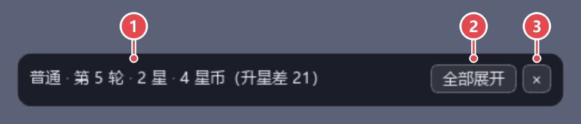

1. 摘要：难度、轮次、星数和星币数。鼠标停在上面可以看到完整的状态。
2. 「全部展开」按钮：显示全部卡片。
3. × 按钮：收到系统托盘，识别继续进行。

出现筹码三选一时自动显示「推荐」卡片，需要您操作时显示对应的提示（见「一局中的操作」）。点击「全部展开」按钮后：

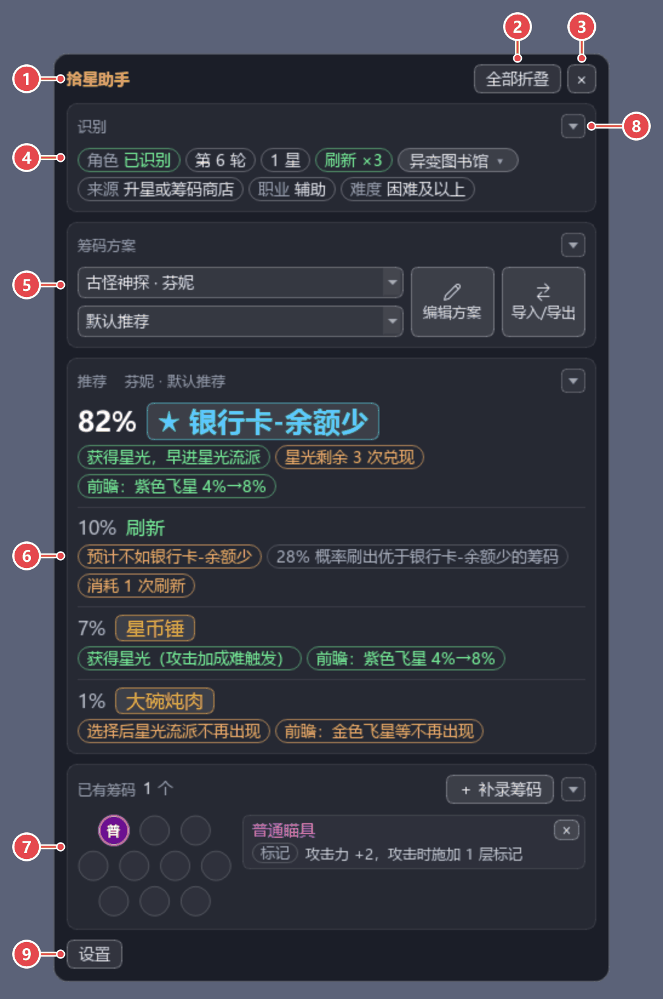

1. 标题「拾星助手」。
2. 「全部折叠」按钮：收回一行。
3. × 按钮：收到系统托盘。
4. 「识别」卡片：从游戏画面上识别到的角色、轮次、星数、星币数、地图、难度等。地图识别有误时，点击地图胶囊手动指定。
5. 「筹码方案」卡片：选择角色和筹码方案，打开编辑、导入/导出窗口。
6. 「推荐」卡片：三个候选筹码和「刷新」的推荐度与理由。
7. 「已有筹码」卡片：本局已持有的筹码。
8. 折叠按钮：收起或展开这张卡片，每张卡片的右上角都有。
9. 「设置」按钮：打开「拾星助手设置」窗口。

悬浮窗可以拖动，位置会记住。详见[悬浮窗的分区和显示方式](#悬浮窗的分区和显示方式)和[「识别」卡片](#识别卡片)。

有新版本时，标题栏下方出现一条提示（对局中不显示）：点击「更新」下载，下好后自动重启换上，详见[升级和卸载](#升级和卸载)。

### 「推荐」卡片

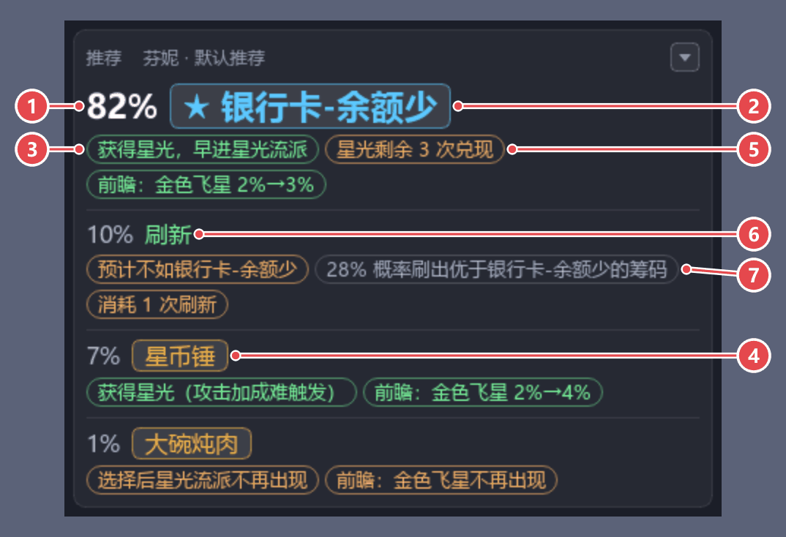

1. 推荐度：本次各选项之间比较得出的相对比例，合计 100%，不表示筹码本身的强弱。
2. 首推：推荐度最高的选项，筹码名前标 ★，字号最大。
3. 绿色的理由标签：加分的理由。鼠标停在标签上可以看到完整的理由。
4. 筹码名按钮：文字和框线按稀有度着色（蓝、紫、金）。鼠标停在上面可以看到全部理由；候选筹码识别有误时，点击它改正。
5. 橙色的理由标签：扣分的理由。
6. 「刷新」：刷新也是一个选项；三个候选筹码都不合适时排在最前面。
7. 灰色的理由标签：只作说明，例如刷新后出现更好筹码的概率。

用自己的筹码方案时，候选筹码前面写位次，不写推荐度：

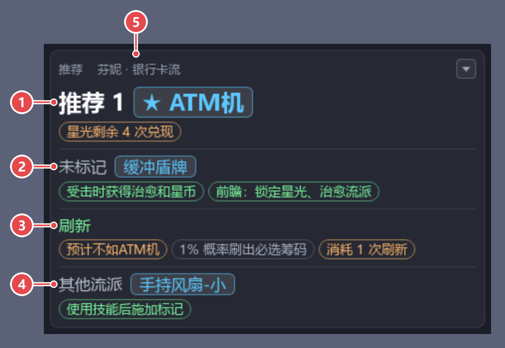

1. 位次：筹码在方案里的档位和顺位，例如「推荐 1」。
2. 「未标记」：方案里没有标档位的筹码，按角色特性计算。
3. 「刷新」：按方案的档位和排在最前的候选筹码比较。
4. 「其他流派」：方案没有列进的流派的筹码，按不选计算。
5. 卡片头：这次推荐按的角色和方案，例如「芬妮 · 银行卡流」；角色是手动指定的时写「芬妮（手动指定） · 银行卡流」。

详见[推荐的写法和规则](#推荐的写法和规则)。

### 「筹码方案」卡片

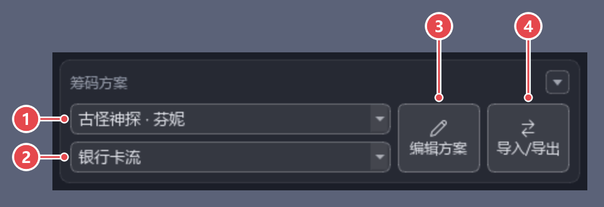

1. 角色下拉框：当前角色，按物理主C、法术C、辅C、钱辅、奶辅、功能辅分组列出。角色识别有误或待识别时，在这里选择。
2. 方案下拉框：「默认推荐」和这个角色的我的方案，对局中途也可以切换。
3. 「编辑方案」按钮：打开「编辑筹码方案」窗口。
4. 「导入/导出」按钮：打开「导入/导出筹码方案」窗口。

对局里认出地图以后，当前角色有标了这张地图的方案时，这一局自动换用它，并提示一次「这张地图有专用方案：已换用「龙宫专用」」。

换用期间方案下拉框下面留一行「本局按地图换用了「龙宫专用」」，点击右侧的「换回原来的」按钮换回保存的方案。

标了适用地图的方案，在方案下拉框的列表里鼠标停在那一项上，可以看到「适用地图：龙宫游乐园、魔法学院」。

详见[筹码方案的规则](#筹码方案的规则)。

### 「编辑筹码方案」窗口

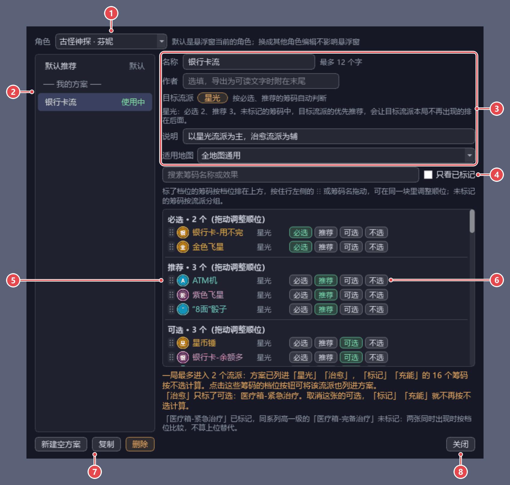

1. 角色下拉框：编辑哪个角色的方案；换成其他角色编辑不影响悬浮窗。
2. 方案列表：「默认推荐」和这个角色的我的方案，正在用的那套写「使用中」。默认推荐只能查看，点击「新建空方案」新建一套再标档位。
3. 名称、作者、目标流派、说明和适用地图：改动立即保存；目标流派按必选、推荐的筹码自动判断。
4. 搜索框和「只看已标记」勾选框。
5. 筹码列表：标了档位的筹码按必选、推荐、可选、不选分块；按住行左侧的 ⋮⋮ 或筹码名拖动，调整同一块里的顺位。
6. 档位按钮：点击标上这一档，再点一下取消。
7. 「新建空方案」「复制」「删除」按钮：给悬浮窗当前的角色新建、复制的方案，悬浮窗直接改用。
8. 「关闭」按钮。

详见[编辑筹码方案的操作](#编辑筹码方案的操作)。

### 「导入/导出筹码方案」窗口

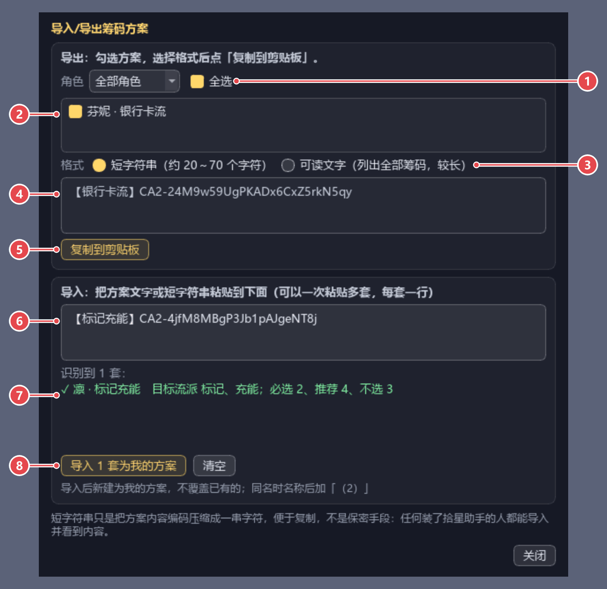

1. 「角色」下拉框和「全选」勾选框：按角色筛选，勾选列出的全部方案。
2. 方案列表：勾选要导出的方案。
3. 格式：短字符串或可读文字。
4. 预览框：要复制的内容，每套一行。
5. 「复制到剪贴板」按钮。
6. 输入框：粘贴别人分享的方案文字或短字符串，可以一次粘贴多套。
7. 识别结果：每套一行，写明能不能导入。导入以后改为每套一行写导入了哪一套，右边是「使用这套方案」按钮。
8. 「导入 N 套为我的方案」按钮：只新建，不覆盖已有的方案。

详见[导入和导出的规则](#导入和导出的规则)。

### 「已有筹码」卡片

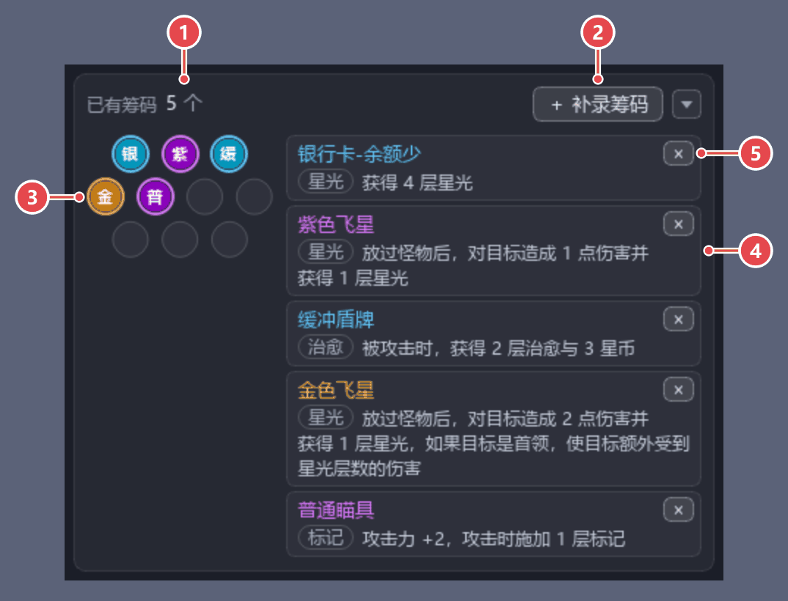

1. 已有筹码的个数，例如「5 个」。
2. 「＋ 补录筹码」按钮：漏记或不经三选一获得的筹码，点击后输入筹码名搜索补录。
3. 图标格子：按 3-4-3 排列，鼠标停在图标上显示筹码名和效果；超过 10 个时用格子下面的箭头翻页。
4. 筹码小卡片：每个已有筹码一张，写筹码名、流派（星光 / 治愈 / 标记 / 充能 / 通用）和效果。
5. 「×」：记录有误的筹码，点击移出；移出后 15 秒内可以点击卡片里那条提示的「撤销」按钮放回。

选择筹码后自动记录；打开游戏的「查看筹码」面板时，按面板上的实际筹码自动改正。筹码多于 10 个时面板分页，翻到哪一页就核对哪一页，没翻到的那几页按原来的记录。筹码越多，卡片往下延伸；悬浮窗超出屏幕高度时改在卡片内滚动。

移出后卡片里一条提示「已从已有筹码中移出「X」」带「撤销」按钮，点击后按原来的位置和来源放回；这期间有了新的筹码三选一、新的一局，或已有筹码又有了变化时，这条提示连同按钮收起，不能再撤销。

### 「拾星助手设置」窗口

点击「全部展开」按钮，再点击底栏的「设置」按钮打开。改动即时生效，点击窗口右上角的 × 关闭。

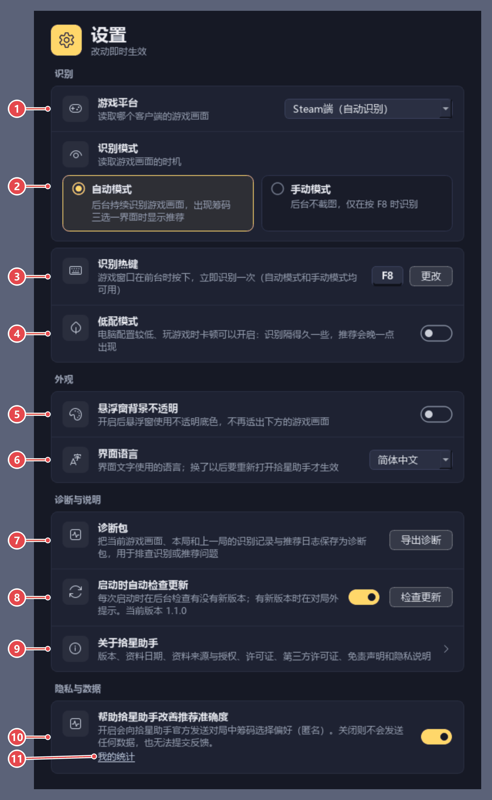

1. 游戏平台：下拉框，默认按最后一次认出的客户端写；可选「Steam端」「TapTap端」或两个同时识别。
2. 识别模式：「自动模式」（默认，后台持续识别）或「手动模式」（只在按热键时识别），点击方块切换。
3. 识别热键：点击「更改」按钮，再按下新的组合键。
4. 低配模式：开关，电脑配置较低、玩游戏时卡顿可以开启：识别隔得久一些，推荐会晚一点出现。
5. 悬浮窗背景不透明：开关，开启后悬浮窗不再透出下方的游戏画面。
6. 界面语言：下拉框，可选「简体中文」「繁體中文」；换了以后要点击这一项下面的「现在重开」按钮重新打开拾星助手才生效。
7. 诊断包：「导出诊断」按钮，生成反馈问题用的诊断包。
8. 启动时自动检查更新：开关（默认开启），开启后每次启动时在后台检查有没有新版本；「检查更新」按钮立即检查一次。
9. 关于拾星助手：点击这一行打开「关于拾星助手」窗口（版本、资料来源、许可证、免责声明和隐私说明）。
10. 帮助拾星助手改善推荐准确度：开关（默认开启），开启时每打完一局存一份对局报告，下次启动时发给拾星助手的服务器，关闭则不会发送任何数据。
11. 我的统计：点击打开「我的统计」窗口。详见「隐私」。

直接截取游戏窗口用不了、改为截取屏幕时，「识别热键」下面另有一项「识别画面」，写明原因和影响。这台电脑有大小核时，「低配模式」下面另有一项「允许拾星助手以高优先级运行以改善识别速度」（拾星助手本来就在大核上时没有）。详见[设置](#设置)。

「检查更新」的结果写在第 8 项的说明处；有新版本时，悬浮窗上另有一条提示（见[升级和卸载](#升级和卸载)）。

### 托盘图标和热键

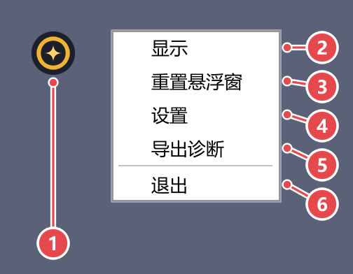

1. 托盘图标：在任务栏右端的通知区域（可能收在「显示隐藏的图标」的箭头里），点击即可显示悬浮窗。
2. 「显示」：显示悬浮窗，放到所有窗口的最前面。
3. 「重置悬浮窗」：展开所有卡片，放到主显示器正中并放到最前面；记下这个位置，以后跟着游戏窗口走，三选一出现时不再自动让开。
4. 「设置」：打开「拾星助手设置」窗口，和底栏的「设置」按钮一样。
5. 「导出诊断」：导出反馈问题用的诊断包，和设置窗口里的「导出诊断」按钮一样；悬浮窗收在托盘里时先显示出来，导出的结果写在悬浮窗上。
6. 「退出」：退出拾星助手。

两个客户端同时识别时两张一起重置：Steam 版那一张放到主显示器正中，TapTap 版那一张紧挨在它右边，右边放不下时放在左边、下边或上边。

- 热键：游戏窗口在前台时按 F8，立即识别一次；在「拾星助手设置」窗口的「识别热键」一行更换。
- 再次双击「拾星助手.exe」也会显示悬浮窗：同一时间只能运行一个拾星助手。

详见[热键和模式](#热键和模式)和[切出游戏与系统托盘](#切出游戏与系统托盘)。

## 一局中的操作

需要您操作时，悬浮窗的边框变为橙色，对应的卡片里写明要做什么：

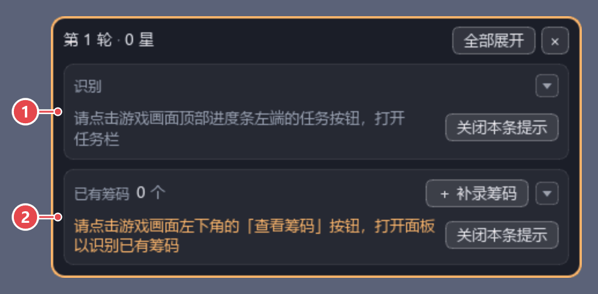

1. 「识别」卡片里的提示：请打开任务栏，用来识别地图。
2. 「已有筹码」卡片里的提示：请打开「查看筹码」面板，用来识别已有筹码。

一局里的操作：

1. 进入对局后，按提示点击游戏画面左下角的「查看筹码」按钮，识别已有筹码，识别后可以关闭面板。
2. 地图需要识别时，按提示点击游戏画面顶部进度条左端的任务按钮，打开任务栏。
3. 出现筹码三选一时，悬浮窗自动显示推荐，在游戏里照常选择筹码即可。
4. 选择后自动记录到已有筹码，悬浮窗收回一行；选的不是首推时，可以点击原因按钮记下原因，不点也不影响使用（约 20 秒后自己收起）。
5. 对局结束后显示「对局 已结束」，下一局开始时自动开始新的一局。

每一步的完整说明见[一局的完整流程](#一局的完整流程)，其他提示见[需要您操作的提示](#需要您操作的提示)。

## 常见问题

- **悬浮窗没有出现在游戏上方**：请检查游戏窗口是否最小化，以及游戏是否运行在独占全屏下；游戏设置里的显示模式选「全屏」或「窗口化」都可以。
- **悬浮窗不见了**：点击过 × 按钮时，悬浮窗收在系统托盘里，点击托盘图标即可重新显示；再次双击「拾星助手.exe」也可以。悬浮窗跑到看不见的地方、收成一行或收起了卡片时，在托盘图标的菜单中选择「重置悬浮窗」：所有卡片展开，悬浮窗出现在主显示器正中。
- **已经开着拾星助手时再次双击「拾星助手.exe」**：不会另开一个，而是把已在运行的悬浮窗显示出来。已在运行的那个约 2 秒内没有回应、并且已经运行超过 15 秒时（刚打开、还在加载的不算，稍等片刻悬浮窗会自己出现），弹窗提示「拾星助手已在运行，但没有响应。」：点击「结束它并重新打开」会结束它并重新打开拾星助手，点击「取消」则不做处理。
- **一直提示「未找到游戏窗口」**：请先启动游戏。工具按窗口标题查找：Steam 版国服是「AstralParty_CN」、国际服是「AstralParty_INT」、TapTap 版是「吉星派对」；在「拾星助手设置」窗口的「游戏平台」一行选了「Steam端」或「TapTap端」时只认这个客户端，开着另一个客户端会提示「游戏平台选的是「Steam端」，没找到它的窗口」，改选带「（自动识别）」的一项或选对这一个客户端即可。选了「Steam端+TapTap端」时两个客户端都要开着，哪个没开，跟它的那一张悬浮窗就会提示找不到这个客户端（提示原文见「设置」），打开这个客户端即可
- **识别不出或识别有误**：先确认游戏的显示模式是「全屏」或「窗口化」、游戏语言是简体中文或繁体中文、游戏窗口不小于建议的大小（见「系统需求」）。识别有误的项可以在悬浮窗上手动改正（见「界面导览」），同一个问题反复出现时请导出诊断包反馈。
- **悬浮窗上提示「识别已停止，请重新打开拾星助手」**：后台识别出错停下了，这次运行不会自动恢复。在托盘图标的菜单中选择「退出」，再双击「拾星助手.exe」重新打开；反复出现时，请把 app\\.tmp\overlay_err.txt 发给作者（见「反馈问题」）。
- **悬浮窗上提示「程序文件夹写不进……」**：程序文件夹放在了受保护的位置（例如 C:\Program Files，或开启了「受控文件夹访问」的桌面、文档），或者被杀毒软件拦截，推荐日志、诊断包等存不进。请退出拾星助手，把整个文件夹（拾星助手.exe 和 app 文件夹一起）挪到别处，例如 D:\拾星助手，再重新打开。
- **悬浮窗上提示「识别所需的图片有 N 张无法保存到 %LOCALAPPDATA%\AstralChipCompass……」**：识别用的图片保存在个人目录 %LOCALAPPDATA%\AstralChipCompass 中，没能写进去，多半是系统盘的空间不足，或者被杀毒软件拦截。清理出磁盘空间、或在杀毒软件中允许拾星助手以后，点击提示右侧的「重试」按钮。
- **悬浮窗上提示「吉星派对 WIKI 的站点防护暂时拒绝了这台电脑的下载……」**：拾星助手已停下全部下载，到提示的时刻自动以较慢的速度继续，不用操作；在此之前用浏览器打开吉星派对 WIKI 也可能被拒绝。已下载的图片照常用于识别，详见「识别用的图片」。
- **悬浮窗上提示「有 1 张识别图片下载失败……」**：个别图片一直下载不了（例如网络连不上某个图片服务器），只有用到这几张图片的立绘、头像或筹码暂时无法识别，其余识别照常进行。不用操作，之后启动时会自动再试（网络等原因下载不了的明天再试）；想马上再试时点击提示右侧的「重试」按钮，不需要这条提示时点击「关闭本条提示」，详见「识别用的图片」。
- **悬浮窗上提示「检测到「替代高 DPI 缩放行为」被改过……」**：app\ACC.exe 的兼容性设置被改过，屏幕缩放不是 100% 时识别会认错。在 app 文件夹里右键点击 ACC.exe，选择「属性」→「兼容性」→「更改高 DPI 设置」，取消勾选「替代高 DPI 缩放行为」，确定后重新打开拾星助手。
- **悬浮窗上提示「自检结果：性能较差……」「自检结果：性能很差……」，或「自检结果：性能一般……」后面带着原因**：第一次运行时的性能自检发现这台电脑上文字识别读得慢（性能一般时是查到文字识别被排到了小核），推荐会晚一些出现，其余功能照常。提示里写查到的原因和建议做法：只能玩家自己做的照提示做，带「是」「否」按钮的是拾星助手能改的（点「是」只改它自己的设置，点「否」这台电脑上不再问），不需要这条提示时点击「关闭本条提示」，详见「设置」。
- **角色一直是「待识别」**：新角色或角色的新造型可能还没有收录。请在「筹码方案」卡片的角色下拉框中手动选择，工具会保存这一局的立绘，下次即可自动识别。
- **候选筹码显示「资料库未收录」**：游戏更新后出现了资料库里还没有的筹码，推荐按同稀有度筹码的平均水平计算，不计前瞻。
- **推荐和自己的判断不一致**：选择自己想要的筹码即可。三选一关闭后，「推荐」卡片问「未选择「X」的原因？」，点击原因（照顾队友、地图因素、推荐有误、想试别的玩法）记入本地的推荐日志（app\logs 文件夹）；「帮助拾星助手改善推荐准确度」开着时随对局报告发出，关着时只留在本机，希望作者参考时可以在反馈问题时一并发送；也可以建立自己的筹码方案。
- **怎么升级到新版本**：有新版本时悬浮窗上会提示，点击「更新」下载，下好后拾星助手自动重启换上（对局中下好的，等对局结束再重启；开着拾星助手的其他窗口时，等这些窗口关掉再重启），设置、筹码方案和推荐日志（app\logs）、诊断包（app\reports）都自动沿用。在拾星助手里更新不了时，点击提示上的「手动下载」，把压缩包解压到新的文件夹，设置、筹码方案、识别用的图片和立绘模板在个人目录（%APPDATA%\AstralChipCompass、%LOCALAPPDATA%\AstralChipCompass）里，同样自动沿用；详见[升级和卸载](#升级和卸载)。
- **一直没有新版本的提示**：自动检查在每次启动约 15 秒后进行，对局中不显示提示；关掉了「启动时自动检查更新」、或者跳过了这个版本时也不提示。想马上查时，在「拾星助手设置」窗口中点击「检查更新」（跳过的版本照样提示），已经是最新版本时写在那一行的说明处。
- **检查更新失败**：下载镜像和 GitHub 都没有连上，提示里写着原因。请检查网络连接（使用代理时的要求同「识别用的图片」）后再点击「检查更新」；一直不行时，用浏览器从下载镜像手动下载（见「升级和卸载」）。
- **新版本下载失败，或解压、核对失败**：提示里写着原因：连不上时检查网络连接；磁盘空间不够（程序文件夹所在的磁盘要剩约 800 MB）时清理磁盘；程序文件夹写不进时，把整个文件夹挪到别处（例如 D:\拾星助手）。处理后在「拾星助手设置」窗口中点击「检查更新」，再点击「更新」重新下载，也可以点击提示上的「手动下载」。
- **新版本没有换上，现在运行的仍是原来的版本**：多半是换的时候程序文件夹里有文件正被别的程序占用（例如打开着里面的文件或文件夹），或者旧版本迟迟没有退出，提示里写着原因，原来的版本照常运行。处理后重新打开拾星助手会自动再换一次；同一个版本两次没换上以后不再自动换，自动检查也不再提示这一版，可以在「拾星助手设置」窗口中点击「检查更新」再试，或点击「手动下载」。
- **新版本启动失败，已换回原来的版本**：换上的新版本没能正常启动（例如被杀毒软件拦截、隔离了文件），拾星助手已自动换回原来的版本，设置和记录都在，自动检查不再提示这一版。确认杀毒软件没有拦截后，可以在「拾星助手设置」窗口中点击「检查更新」再试，或点击「手动下载」把压缩包解压到新的文件夹再运行。
- **在拾星助手里更新时被杀毒软件拦截**：个别杀毒软件可能拦截下载的新版本或换版本的程序，表现为下载失败、没能启动换版本的程序或新版本启动失败，原来的版本照常运行。可以在杀毒软件中把程序文件夹设为信任、从隔离区恢复被隔离的文件以后，在「拾星助手设置」窗口中点击「检查更新」再试，或点击「手动下载」手动更新。
- **怎么卸载**：删除整个程序文件夹即可；不再使用时，个人目录 %APPDATA%\AstralChipCompass、%LOCALAPPDATA%\AstralChipCompass 可以一并删除。
- **设置、筹码方案和识别用的图片存在哪里**：设置和筹码方案保存在个人目录 %APPDATA%\AstralChipCompass 中，识别用的图片和立绘模板保存在 %LOCALAPPDATA%\AstralChipCompass 中（在资源管理器的地址栏输入这个路径后按回车即可打开），换新版本时自动沿用。各个文件见「文件夹说明」。
- **截图或录屏里悬浮窗闪烁、偶尔截不到悬浮窗**：只在「识别」卡片最上面有「已改为截取屏幕」的提示时会这样。把鼠标停在提示上查看原因并处理后，重新启动游戏或拾星助手，会再次尝试直接截取游戏窗口。
- **游戏窗口四周有一圈黄色细框**：Windows 10 上直接截取游戏窗口时由 Windows 显示，拾星助手无法关闭。手动模式下约 30 秒没有按热键识别、或识别暂停约 30 秒后，截取停止，黄框随之消失。
- **杀毒软件误报**：程序由 Nuitka 编译、没有数字签名，个别杀毒软件可能误报。确认压缩包是从下载镜像或发布页面下载的完整文件后，可以在杀毒软件中把程序文件夹设为信任，或从隔离区恢复被隔离的文件；不确定文件是否完整时，从下载镜像或发布页面重新下载。
- **双击「拾星助手.exe」后提示「找不到 app\ACC.exe，请把压缩包整个重新解压。」**：拾星助手.exe 旁边缺少 app 文件夹。请把压缩包整个重新解压，拾星助手.exe 和 app 文件夹放在一起。
- **双击「拾星助手.exe」后提示「无法启动 app\ACC.exe：程序所在文件夹的路径太长……」**：程序所在文件夹的路径太长。请把整个文件夹移到路径较短的位置（例如 D:\拾星助手）后再打开。
- **双击「拾星助手.exe」后提示「……可能被杀毒软件拦截……」**：确认压缩包是从下载镜像或发布页面下载的完整文件后，在杀毒软件中把程序文件夹设为信任，或从隔离区恢复被隔离的文件。
- **双击「拾星助手.exe」后提示「拾星助手启动后出错退出……」**：拾星助手启动以后、悬浮窗出来之前出错退出了，提示里写着错误代码和原因，能照做的先照做（例如重新解压）。仍然这样时，请把提示里写的崩溃记录 crash.txt 和同一文件夹里的错误记录 overlay_err.txt 发给作者（见「反馈问题」）。
- **程序无法启动**：双击「拾星助手.exe」后弹出提示的，先照提示做；没有提示或照做了还是打不开时，把下载的压缩包整个重新解压（不要只把「拾星助手.exe」拷出来），再双击「拾星助手.exe」。仍然打不开、想进一步查原因时，运行自检看看：打开 app 文件夹，在资源管理器的地址栏输入「cmd」后按回车，打开命令行；再输入「ACC.exe --selfcheck」后按回车，它检查程序文件是否完整，检查结果写在 app\\.tmp\selfcheck.json；错误信息追加在 app\\.tmp\overlay_err.txt 的末尾（超过约 1 MB 时，之前的记录在同一文件夹的 overlay_err.old.txt），反馈时请把这两个文件（有崩溃记录 crash.txt 时也带上）一起发给作者（见「反馈问题」）。

## 详细说明

下面按悬浮窗的各部分和各个窗口，逐项说明界面上的内容和操作。

### 悬浮窗的分区和显示方式

悬浮窗从上到下是标题栏、全局提示（下载进度、诊断包位置、新版本等，有内容时才出现）、「识别」「筹码方案」「推荐」「已有筹码」四张卡片和底栏。

- 一行：平时只显示标题栏一行，写难度、轮次、星数和星币数，例如「普通 · 第 5 轮 · 2 星 · 4 星币（升星差 21）」；星币够升星时写「120 星币（升星余 95）」，3 星以后只写星币数。游戏窗口不在前台、识别照常进行时前面加「识别中 · 」；识别暂停时照写「识别 已暂停」，例如「识别 已暂停 · 噩梦 · 第 3 轮 · 1 星 · 120 星币」。右侧是「全部展开」按钮和 × 按钮。一行放不下时依次去掉开头的「识别中」、去掉难度、把「升星差」「升星余」缩成「差」「余」（例如「第 12 轮 · 2 星 · 45 星币（余 20）」），仍放不下时从末尾省略；悬停在这一行上可查看完整内容（含地图）。需要您操作时，对应的卡片出现在下方，只显示那几行提示。
- 三选一展开：出现筹码三选一时自动显示「推荐」卡片，卡片头写这次推荐按哪个角色、哪套方案计算（例如「芬妮 · 银行卡流」，见「筹码方案的规则」），标题栏写这次三选一的来源和剩余刷新次数，例如「来源 升星或筹码商店 · 刷新 ×3」。刷新次数的数字没读出来时，和其他没读出来的数字一样写橙色的「刷新次数 待识别」，不写可能不对的次数；鼠标停在上面可以看到「刷新次数没读出来，按一次都没用过估计为 4 次，不按多出来的刷新算。」这样的说明（推荐照这个估计计算，见「推荐的写法和规则」里「刷新」那一条）；本次之后预计不再有筹码三选一时，剩余的刷新都可以连续使用，说明写「刷新次数没读出来，按一次都没用过估计为 4 次；本次之后预计没有筹码三选一，剩余刷新可以连续使用。」。
- 全部展开：点击标题栏的「全部展开」按钮后，四张卡片和底栏都显示，收起的卡片保持收起。底栏只有「设置」按钮（见「设置」）；「导入/导出」按钮在「筹码方案」卡片里「编辑方案」按钮的右边。标题栏只剩标题、「全部折叠」按钮和 × 按钮，点击「全部折叠」后收回一行。筹码三选一界面关闭后，在「推荐」卡片里可以回看上一次推荐。
- 每张卡片右上角有自己的折叠按钮（小号方形箭头按钮）：▾ 表示卡片已展开，点击后收起这张卡片；▸ 表示已收起，点击后展开。收起后只剩一行摘要（例如「第 9 轮 · 2 星 · 刷新 ×4 · 星趴·梦想号」「芬妮 · 银行卡流」「首推：美工刀-锋利 75%」）。收起状态会记住；第一次使用（个人目录里还没有设置文件）时「已有筹码」卡片默认收起，其余三张展开。出现新的筹码三选一或需要您操作的提示时，对应的卡片自动展开。
- 下拉列表里，鼠标所在的一行以亮灰色圆角框标出，当前选中的一项左边有一根短条（颜色随 Windows 的强调色）。
- 位置：悬浮窗显示在游戏画面右侧「刷新」按钮的下方，可以拖动，位置会记住。游戏窗口较小时（例如 1920×1080、100% 缩放），展开的「推荐」卡片会挡住第 3 个候选筹码。没有拖动过悬浮窗时，出现筹码三选一期间它自动移到挡得最少的地方：窗口化且屏幕上有空间时放到游戏窗口外侧，否则放到游戏画面右下角或左下角（不挡「刷新」按钮）；三选一关闭后回到原处。拖动过之后一直放在拖到的位置（单击悬浮窗不算拖动；拖到屏幕外松手时马上挪回屏幕内）。

### 一局的完整流程

1. 进入对局后，悬浮窗提示「请点击游戏画面左下角的「查看筹码」按钮，打开面板以识别已有筹码」。打开面板后，工具自动识别自己已持有的筹码，并提示可以关闭面板。程序每次启动都重新识别对局状态，不沿用上一次运行时的记录。从选角界面开始看着的一局不提示（已有筹码就是空的）；打开工具时还在主菜单、房间等对局外的画面，之后进入对局时还在第 1、2 轮、没有先出现筹码三选一的，也算从开局看着，不提示。
2. 地图需要识别时，悬浮窗提示「请点击游戏画面顶部进度条左端的任务按钮，打开任务栏」。打开任务栏后，工具读取任务文字识别地图，并提示可以关闭任务栏。这条提示在进入对局、读到轮次以后才出现（全部展开时也一样）：还在选角界面等对局外的画面时打不开任务栏，不提示。
3. 出现筹码三选一时，悬浮窗自动显示「推荐」卡片。按推荐度从高到低列出三个候选筹码和「刷新」，首推（推荐度最高的选项）前标 ★、字号最大。用我的方案时按方案的档位和顺位排列（见「筹码方案的规则」）。在三选一界面上点「隐藏」查看棋盘时，「推荐」卡片照常留着；点「显示」回到三选一后照常识别。
4. 选择筹码后，工具自动记录到已有筹码，悬浮窗收回一行（标题栏照常显示难度、轮次、星数和星币数；上一次推荐可在全部展开后的「推荐」卡片里回看）。选的不是首推时，「推荐」卡片里问一句「未选择「X」的原因？」，可点「照顾队友」「地图因素」「推荐有误」「想试别的玩法」之一记入推荐日志，不点也不影响使用；不想选原因时，可以点问句右边的「×」收起，这一次不记原因，全部展开时也不再问。一行显示时这一问约 20 秒不点就收起，这一次不记原因；全部展开时照旧留到下一次筹码三选一，收起以后点击「全部展开」也还能点。筹码三选一显示期间，工具每秒约 10 次查看点中的是哪一个筹码（绿框），点中以后马上点「确定」也记得上；快到约 0.1 秒以内、没看到点中的是哪一个时，三选一关闭后照旧提示补录（见「需要您操作的提示」）。
5. 思考时间用完时，游戏会自动选择最左侧的筹码，即使已经点中了别的筹码（绿框）也一样。这时工具先按点中的筹码记录；之后打开「查看筹码」面板时，按面板上的实际筹码改正已有筹码和推荐日志里的选择记录，并在提示里写明改正了什么。
6. 对局结束、出现结算画面后，悬浮窗显示「对局 已结束」，本局的记录保留到下一局开始；下一局的选角界面出现时自动开始新的一局。

### 「识别」卡片

- 状态胶囊：「第 9 轮」「2 星」「刷新 ×4」、地图名、「来源 升星或筹码商店」「职业 攻击」等。对局中还没读到的项写「星数 待识别」这样的写法，标橙色。角色待识别时不显示职业（按上一局的角色算出来的职业不一定是这一局的）。
- 状态胶囊的第一项是识别本身的状态：游戏窗口不在前台、识别照常进行时是暗色的「识别 照常进行」，识别暂停时是「识别 已暂停」，下载识别用的图片期间是「识别 暂不可用」（见「切出游戏与系统托盘」；只补充下载少量图片时，以及被吉星派对 WIKI 的站点防护暂时拒绝过、以较慢的速度继续下载时，识别照常进行，见「识别用的图片」），后台识别出错停下以后一直是「识别 已停止」（见「需要您操作的提示」）。
- 接着是角色状态（「角色 已识别」「角色 手动指定」「角色 待识别」）；手动指定时紧跟「恢复自动识别」按钮。选择角色的角色下拉框在下面的「筹码方案」卡片里。
- 星数后面是星币数，例如「120 星币」；知道下一次升星要多少星币时写成「15 星币（升星还差 5）」或「120 星币（升星后余 95）」，把鼠标停在状态胶囊上可以看到「升至 2 星需要 20 星币，还差 5 星币。」这样的说明。星数还没读到、或已经 3 星时只写星币数；读不到星币数时不显示这一项。星币数约 6 秒读一次，筹码三选一期间不读；新的数要连续两次读到才显示，读不到时保持上一次的数。自己「昏迷」、头像认不出时，按记住的玩家名字找自己那一行，照样读星数和星币数。一行显示的摘要里星币数的写法略短（见「悬浮窗的分区和显示方式」）。
- 直接截取游戏窗口用不了时，卡片最上面以「⚠」开头提示原因，例如「⚠ Windows 未允许直接截取游戏窗口，已改为截取屏幕：游戏窗口不在前台时暂停识别。」把鼠标停在提示上可以看到错误代码和处理办法；点击「关闭本条提示」后，这次运行不再提示同一原因。
- 识别出错时，标题栏下方（一行显示时在摘要里）提示是哪一项没读出来，例如「进度条、星数这次没读出来，已自动重试；多次出现请点击「设置」窗口中的「检查更新」按钮，更新到最新版拾星助手。」，约 15 秒后收起。同一项识别出错时，提示 10 分钟里只显示一次（错误记录照样每次都记）。
- 地图胶囊可以点击，从下拉列表中手动指定地图；选「地图：自动识别」恢复自动识别。
- 难度：知道本局难度时显示难度胶囊，例如「难度 噩梦」。依据是开局前组队房间勾选的难度、创建房间界面和自建房间的难度设置、「匹配成功」画面和结算画面上的难度文字，或者对局中按地图和进度条上的进度上限推算。推算出噩梦或疯狂、分不出是哪一个时写「难度 噩梦及以上」；进度上限和其余难度都对不上、只和极限对得上时（御魂庆典 17 格）写「难度 极限」，和疯狂相同时（星趴·梦想号、水乡古镇）分不出，按疯狂；分不出是困难还是噩梦及以上时写「难度 困难及以上」，这时不按噩梦及以上提高推荐；还不知道时不显示。具体难度用于三处：噩梦及以上时提高摩托头盔-高级的推荐，本局是极限时提高复仇之戟、诅咒之剑、三叉戟的推荐，进度条上的进度上限读不出时按这一难度的进度上限估计之后还有几次筹码三选一（极限时一局的筹码任务数也按极限的算）；筹码概率只分普通和困难及以上（见「推荐的写法和规则」）。
- 对局结束：识别到结算画面后，状态胶囊显示「对局 已结束」（排在角色状态之后；切出游戏时角色状态前面还有「识别 照常进行」），一行显示的摘要以它开头，后面只写地图和难度（例如「对局 已结束 · 异变图书馆 · 噩梦」，轮次、星数在悬停说明里）。结算画面没截到时，对局中回到房间、出现「匹配成功」画面或奖励画面也算结束，但要比结算画面晚一点：隔一会儿（约 3 秒）连续两次认出才算（只认出一次不算；离开对局时先在别的画面上停了几秒的，最多要十来秒）。中途退出、断线回到主菜单时同样算结束；之后又连回了同一局（中间没有出现房间、选角界面等画面，读到的轮次不比离开时小）时，不开新的一局，「对局 已结束」收起，接着记这一局。本局的已有筹码、星数、轮次和地图保留到下一局开始时清空，上一次推荐可以在「推荐」卡片里回看；这时在「拾星助手设置」窗口中点击「导出诊断」按钮（见「反馈问题」），诊断包里是整局的识别记录。打开「查看筹码」面板、补录这类只对进行中的对局有意义的提示随之收起。下一局开始（选角界面、下一局的对局画面或筹码三选一界面出现）时自动判定为新的一局：结算画面结束以后的、或看到选角界面开始的，只作说明（约 15 秒后收起）；房间、主菜单、「匹配成功」画面或奖励画面结束以后按对局画面或筹码三选一判定的，带「撤销」按钮（对局中途误认出这几种画面时就是这种情况），撤销时「对局 已结束」一起撤回。
- 把鼠标停在状态胶囊上，可以看到星数、职业、地图、难度的识别依据，对局结束的依据，三选一期间刷新次数没读出来时按几次估计，以及队友和畸变组件。
- 进度上限：对局画面上方进度条的红叉所在的格为本局的进度上限，连续两次读到同一个值后采用，用于估计剩余的筹码三选一次数；读不到时按地图资料中对应难度的进度上限计算（画面上读到了具体难度时取那一难度，只知道是困难及以上时按疯狂难度）。
- 来源：筹码三选一标题上方出现「……正在选择强化筹码…」时，为全队同时进行的任务三选一，来源按任务计算。其他玩家都选完后这一行会消失，同一次三选一里刷新后仍按任务来源计算。

### 推荐的写法和规则

- 每个选项（含「刷新」）一块：第一行是推荐度（百分数，例如「75%」；用我的方案时写位次，见「筹码方案的规则」）和筹码名按钮（文字和框线按稀有度着色：蓝、紫、金）；下面是这个选项的主要理由，每条一个标签。标签上只写要点，不写分数：绿色表示加分的理由，橙色表示扣分的理由，灰色只作说明；标签按对推荐的影响从大到小排列，扣分多的理由可能排在加分少的前面。鼠标停在标签上可以看到完整的理由。选项之间有一条细线分隔。
- 同一个效果有一条加分、一条扣分的理由时，合成一个标签写净效果，例如星币锤对较少与怪物交战的芬妮写「获得星光（攻击加成难触发）」：星币锤获得星光的部分有用，攻击时花费星币增加攻击力的部分很少触发。颜色按两条合起来是加分还是扣分；鼠标停在标签上可以看到两条完整的理由。
- 默认推荐（方案下拉框的第一项，见「筹码方案的规则」）按角色特性计算：角色的特性、推荐流派、组合、队友、难度、收入折算、前瞻等，理由标签写各自的要点。游戏内置推荐分（基础分、成长分、角色分、标签分、关键词分）只用于判断游戏里的推荐角标，不计入本工具的推荐；前瞻按五折计入。用我的方案时，标了档位的筹码按档位排列，见「筹码方案的规则」。
- 推荐流派要尽量保住的角色（例如南希露：标记、治愈；有的角色只保住其中几个推荐流派，下面说的推荐流派指要保住的那几个），默认推荐里其他流派的筹码选择后会让推荐流派本局进不全时扣分：一个流派都还没进入时，理由标签写「选择后标记、治愈只能再进入一个」；已进入一个其他流派、选择后流派名额占满时写「选择后标记、治愈流派不再出现」（已进入标记或治愈时只写没进入的那一个，例如「选择后治愈流派不再出现」）。鼠标停在标签上可以看到整句。不属于流派的筹码（例如拳击手套、精品剑盾）不受影响；美工刀属于治愈流派，但还没有治愈来源（医疗箱、大碗炖肉等）时，它的加分按之后获得治愈来源的概率折算，另按同一个概率提前加一部分之后配上治愈来源才有的组合分，理由标签写「之后获得治愈来源 61%」。已进入其他流派（例如星光）、标记和治愈本局已经进不全时，已进入的那个流派和标记、治愈一样加分，理由标签写「推荐流派：星光（已进入）」：之后的打法是这个流派加剩下的一个推荐流派；星光、充能都已进入、标记和治愈一个也进不了时不加。识别为普通难度时，安全气囊、时间怀表、重生人偶和三种摩托头盔对南希露扣分，理由标签写「普通难度生存压力小，收益低」（普通难度生存压力小，南希露又能远程挑战怪物）；困难及以上、难度还没识别时不扣。
- 还没有充能、标记、星光筹码时，这三个流派的筹码按之后获得配套筹码的概率提前加分，理由标签写「之后获得配套筹码 87%」：之后的三选一里出现、并且会选的同一流派配套筹码带来的收益。
- 把鼠标停在筹码名按钮上，可以看到这个筹码的全部理由：筹码的稀有度、标签、流派和效果，然后是筹码方案、特性、组合、队友、收入折算、前瞻等（前瞻对推荐的影响很小时不列出，与标签一致；预计之后不再有筹码三选一时不计前瞻），同样按影响从大到小排列、按加分绿色扣分橙色着色，最后一行是推荐度，首推的写「推荐度 75%（首推）」。卡片上合成一个标签的两条理由，在这里分两行列出。
- 把鼠标停在推荐度上，可以看到推荐度的含义：本次各选项之间比较得出的相对比例，各选项合计 100%，不表示筹码本身的强弱。显示的推荐度取整后合计正好 100%；不到 1% 的写「<1%」，超过 99% 的写「>99%」。
- 因为队友而加分的理由写明是哪几名队友，例如「配合队友：邦妮、凛」，电脑队友后面写「（电脑）」，例如「配合队友：潘大猛（电脑）」；队友的角色离不开某种筹码（例如邦妮离不开标记）、而这次的候选里有能提供它的筹码时，只要这个筹码本身也够好、拿了以后不会让自己的推荐流派（用我的方案时是方案列的流派）再也进不去，就排在第二位，理由写「配合队友：邦妮刚需标记」，第一位仍按对自己的收益。
- 同系列的筹码同时出现时（例如两张银行卡），各自下面写一行比对方多什么，例如「比金色多 4 层星光」；鼠标停在这一行上可以看到两张的效果对照。不算上位替代的两张推荐度接近时，稀有度高的一张排在前面。高一级包含低一级的全部效果且更强时（例如摩托头盔-中级和-高级；判断时不计标签里的「通用」，所以手持风扇-小和-大也算，现在共 15 对），低一级写「被金色上位替代」，不参与推荐度比较，排在最后；鼠标停在上面可以看到「同系列的「摩托头盔-高级」包含「摩托头盔-中级」的全部效果且更强，「摩托头盔-中级」不参与推荐度比较。……」这样的说明。另一个候选和对方颜色相同时，颜色后面写上对方的筹码名，例如「被金色（摩托头盔-高级）上位替代」「比蓝色（银行卡-余额少）多 3 层星光」。
- 「刷新」一块用三个标签说明：刷新是否优于直接选择当前最好的候选筹码（即卡片上排在最前的那张筹码，因队友刚需排到第二位的也算；「预计优于X」「预计不如X」或「与X相当」；相差很小时后面写明略优或略差，例如「与X相当（略优）」）、刷新后出现更好筹码的概率（例如「30% 概率刷出优于X的筹码」；不到 1% 时写「不到 1%」，超过 99% 时写「超过 99%」），以及刷新的代价（「消耗 1 次刷新」；刷新次数有多出来的时为「留 2 次，多出 2 次不必留」这样的写法，之后预计不再有筹码三选一时为「之后无需保留刷新」，之后还有三选一、只是很少（不到 1 次，用掉 1 次刷新几乎没有影响）时为「之后几乎无需保留刷新」）。第一个标签的结论已经算上了这次刷新的消耗，概率不算；两者方向相反时（例如结论是「预计不如X」，刷出更好筹码的概率却过半），只显示算上消耗的结论和刷新的代价，不显示概率；结论是相当、概率却很偏（不超过 20% 或不低于 80%）时同样不显示概率。刷新次数有多出来的：之后的筹码三选一按每次留 1 次刷新算（之后预计还有几次三选一是估计的，次数向上取整，不到 1 次时也留 1 次），另多留 1 次以防估少（实际的三选一常比估计的多一次左右）；剩余的刷新比要留的多时，多出来的几次现在使用不算代价，可以连续使用，刷新按最多连续刷新多出来的次数来估计，标签的悬停说明会写明留了几次、为什么多留；之后预计不再有筹码三选一时，剩余的刷新都算多出来的。例如 3 星、剩 4 次刷新、之后预计还有不到 1 次三选一：留 2 次，多出来的 2 次可以连续使用；之后不再有三选一时 4 次都能用。刷新次数没有读出来时（例如刷新按钮被挡住），按一次都没用过估计剩余次数，这个估计可能偏多，所以不按多出来的算：之后还有三选一时只按刷新一次计算、算上消耗，「消耗 1 次刷新」的悬停说明会写明次数是估计的。刷新没有代价时，第一个标签的悬停说明还会写明「刷新会放弃本次的三个候选筹码」。用我的方案时刷新那一行另有写法，见「筹码方案的规则」。
- 之后预计还有几次筹码三选一（刷新留几次、刷新的代价、前瞻都按它）：剩下的升星（到 3 星）加上本局的任务和筹码商店（按地图的筹码任务数和一次筹码商店，随轮次往后减少）。一局没有固定的结束轮次（打倒首领就赢，进度条走到红叉才输），3 星以后还会去筹码商店买，所以 3 星以后、轮次读得出时，进度条走到头之前不会估成之后没有三选一，至少按每轮约 0.2 次算。已经拿了循环往复、它给的那次三选一还没给时，另外多算 1 次：要在三选一里认出选了循环往复（包括没看到点中的是哪一个、三选一关闭后按提示补录时点的），当时轮次也读得出，才知道那次什么时候给；在「查看筹码」面板上核对出来的、用「＋ 补录筹码」补录的不多算。到期以后过了一轮还没认出那次三选一，就不再多算；到期那一轮已经到了进度上限（那时一局已经结束）时也不多算。进度条走到头前只剩一两轮时，按剩下的轮数封顶的那几次里先留出这 1 次，其余的才算升星。0～2 星时这 1 次的稀有度按到期时预计的星数估计（和给循环往复估值时一样）。那次三选一给了以后，它不占本局任务和筹码商店的次数。这是估计，真到最后一次时也可能还按有三选一算，留着一两次刷新不用。
- 卡片底部以「⚠」开头的附注，表示推荐可以参考但可能不准，例如首推是刷新时的「三个候选筹码的适配度均偏低」（三个候选筹码都不太适合当前角色，所以推荐刷新）、地图待识别时按候选地图平均计算、资料库未收录的筹码按平均水平计算、畸变组件的提示。资料库未收录的筹码，理由标签「未收录：按平均水平」是灰色，只作说明。
- 本局难度还没有识别出来时，推荐按困难及以上计算；生存类筹码的理由标签「难度：生存类」的悬停说明以「难度待识别，按困难及以上计算」开头。
- 普通难度：普通难度的筹码稀有度概率和困难及以上不同，工具按筹码三选一界面上显示的概率自动识别。识别为普通难度后，「识别」卡片显示「难度 普通」，推荐附注「筹码概率按普通难度计算」，筹码概率和进度上限都按普通难度计算。困难、噩梦、疯狂、极限的筹码概率相同，按同一套概率计算。新的一局开始时重新识别。
- 噩梦及以上难度：怪物数值更高，摩托头盔-高级对所有角色都提高推荐（理由标签「难度：噩梦及以上」）。困难难度、或分不出是困难还是噩梦时不提高。
- 极限难度：画面上读到本局难度是极限，或者按进度上限推算出极限（御魂庆典 17 格，只有极限是这个格数）时，复仇之戟、诅咒之剑、三叉戟对所有角色提高推荐（理由标签「难度：极限」）。星趴·梦想号、水乡古镇的极限和疯狂进度上限相同，只靠进度上限推算时分不出，按疯狂，不提高。
- 水乡古镇怪物压力较低：在这张地图上，三种摩托头盔不因难度提高推荐（噩梦及以上的提高也不加）；地图待识别时照常提高。
- 候选筹码识别有误时，点击对应的筹码名按钮，在下方输入或选择正确的筹码名，推荐立即按改正后的筹码重新计算。
- 识别到的筹码名有错字、但按图标边框颜色和筹码表只对得上一个筹码时（例如紫色边框的「卷キ手套-中级」只能是拳击手套-中级），直接按这个筹码计算，不提示「匹配度低」；鼠标停在筹码名按钮上可以看到识别到的文字。筹码名只读到几个筹码共有的一部分时（例如只读到「飞星」，紫色飞星和金色飞星都有），先不给推荐，约半秒后再读，读全后再给；再读一次仍读不全时（一般在半秒到 1 秒后），按图标边框颜色选一个计算，并提示「匹配度低」，之后读全了这条提示自动去掉。
- 筹码三选一刚出现时，有候选筹码还没显示出来（例如被入场动画或升星特效挡着）时先不提示，约半秒后再识别一次三个候选筹码，读全后照常给出推荐；再读一次仍有候选筹码识别不出时（一般在半秒到 1 秒后），才列出候选筹码，请点击标为橙色的筹码名按钮改正。
- 给出推荐以后，同一次三选一里有一两个候选筹码的名字突然读得不准、连图标边框颜色也看不出，其余的照旧（例如被游戏弹出的小窗、动画临时挡住）时，这一次识别不采用：推荐和候选筹码照旧，点中的是哪一个按原来的位置再看。三个候选筹码都变了时（点「刷新」换上的新一组、紧接着出现的另一次三选一）照常识别。
- 点击游戏里的「刷新」后，新的候选筹码要过一会儿才显示完整。还没识别完整时，「推荐」卡片保留刷新前的推荐，卡片头和标题栏写「正在刷新」，识别完成后（一般在 1 秒内）自动换成新的推荐，这期间点筹码名按钮不会打开改正栏；再读一次仍有候选筹码识别不出时（一般在半秒到 1 秒后），才列出候选筹码，请点击标为橙色的筹码名按钮改正。

### 筹码方案的规则

- 「筹码方案」卡片在「识别」卡片下面：上面是角色下拉框，下面是方案下拉框；右边并排两个一样宽的图标按钮，「编辑方案」（笔形图标）打开「编辑筹码方案」窗口，「导入/导出」（左右双箭头图标）打开「导入/导出筹码方案」窗口。卡片收起时卡片头写角色和方案名，例如「芬妮 · 银行卡流」。
- 角色下拉框按物理主C、法术C、辅C、钱辅、奶辅、功能辅分组列出角色，每一组前面有一行不能选的组名，例如「── 物理主C ──」（「编辑筹码方案」「导入/导出筹码方案」窗口里的角色下拉框同样分组）。
- 方案下拉框只列当前角色的方案：第一项是「默认推荐」，即拾星助手自带的筹码方案（按角色特性计算）；建过自己的方案时，下面是不能选的分组标题「── 我的方案 ──」和各套我的方案。鼠标停在下拉列表的各项上，「默认推荐」写「拾星助手自带的筹码方案：按角色特性计算。推荐流派：治愈」这样的说明，我的方案写方案的说明（没写说明时写目标流派）。每个角色记住上次用的方案。资料库未收录的角色在角色下拉框里写「（资料库未收录）X」，方案下拉框不可用。
- 悬浮窗用哪套方案：每个角色各记一套，换的方法有三种：在方案下拉框里选；在「编辑筹码方案」窗口里给悬浮窗当前的角色新建空方案、复制、复制为我的方案，悬浮窗直接改用新的这套；在「导入/导出筹码方案」窗口里导入以后点击「使用这套方案」按钮。「编辑筹码方案」窗口的方案列表里，悬浮窗正在用的那一套行尾写「使用中」。
- 对局中途可以切换方案：正在显示筹码三选一时，推荐立即按新方案重新计算，卡片里提示「筹码方案已切换为「银行卡流」，已按新方案重新计算推荐」。在编辑窗口里新建、复制或导入以后改用的，没有筹码三选一时也提示一次「筹码方案已切换为「方案 1」」（在方案下拉框里选的不提示，下拉框上已经看得到）。为免误换，鼠标停在方案下拉框上滚动滚轮不会切换方案。
- 按地图换用方案：对局里认出地图以后，如果当前角色的方案里有标了这张地图的，「筹码方案」卡片自动换用这一套，并提示一次「这张地图有专用方案：已换用「龙宫专用」」；地图改判时跟着再换、再提示一次。换的只是这一局实际用的方案，不改保存的方案，也不写进方案文件。换着的时候，方案下拉框下面一直留一行「本局按地图换用了「龙宫专用」」，悬浮窗收成一行时「筹码方案」卡片也显示着这一行。点击右侧的「换回原来的」按钮，换回保存的方案，提示「已换回「我的通用」，这一局不再按地图自动换方案」，这一局不再自动换；保存的是默认推荐时，这句提示和按钮的悬停说明里都写「默认推荐」。这一局里在方案下拉框里换过方案，或在「编辑筹码方案」窗口里新建、复制、导入以后改用了别的方案，同样不再自动换。对局结束、开始新的一局时回到保存的方案。方案下拉框里标了适用地图的方案，鼠标停在下拉列表的那一项上，悬停说明的最后一段写「适用地图：龙宫游乐园、魔法学院」（按地图的先后，用「、」隔开）；一张地图都没标的通用方案不写这一段。
- 「推荐」卡片的卡片头写这次推荐按哪个角色、哪套方案计算，例如「芬妮 · 银行卡流」（用默认推荐时「芬妮 · 默认推荐」，角色是手动指定的时「芬妮（手动指定） · 银行卡流」），写法和「筹码方案」卡片收起时的卡片头相同；放不下时先截短方案名。角色待识别、推荐暂停时不写。全部展开回看上一次推荐时写上一次按的角色和方案。鼠标停在上面可以看到去哪里换角色和方案。
- 默认推荐和我的方案不混用：选了我的方案时，方案里没标档位的筹码只按角色特性、组合、队友、难度、收入折算、前瞻等计算，不再用默认推荐的任何部分（推荐流派的加分、要保住推荐流派时的扣分）。
- 档位和顺位：方案把筹码分为必选、推荐、可选、不选四档，同一档里的筹码有先后（顺位）。用我的方案时，「推荐」卡片按「必选 > 推荐 > 可选 > 未标记 > 不选」排列候选筹码：必选按顺位；推荐、可选先按顺位，再按档位前瞻调整（见「同一档的先后」）；未标记的筹码之间按角色特性等计算的结果排；队友刚需（见「推荐的写法和规则」）只在未标记的筹码之间调整先后，之后刷新排到它前面、或者别的候选因为下面两条挪动了，它不在第二位时，理由的悬停写它实际排在第几位（例如「该筹码可提供，排在第三位」）。另有两种情况会挪动先后：收入快用不上的筹码按低一档排，选了会少拿方案里更要紧的筹码的候选排到后面（见下面两条）。
- 位次：候选筹码第一行写位次，不写推荐度：「必选 1」「推荐 2」「可选 3」「不选 1」，未标记的写「未标记」，未列进方案的流派的筹码写「其他流派」（见下）；首推前照旧标 ★。鼠标停在位次上可以看到整句，例如「筹码方案「银行卡流」：推荐，顺位 2」「筹码方案「银行卡流」：未标记，按角色特性计算」。筹码名按钮的悬停明细里，方案这一项的分项名是「筹码方案」，最后一行写位次，例如「筹码方案：推荐 1（首推）」；「推荐」卡片收起时卡片头写「首推：美工刀-锋利（推荐 1）」。未标记的筹码属于目标流派（列进方案、有必选或推荐的流派）时，另有理由标签「筹码方案：星光流派」。
- 档位前瞻：标了档位的候选，前瞻那一条按方案的档位写：选了这张以后，方案里还没持有、不在这次候选里的必选、推荐筹码（方案里没有这样的必选、推荐时说可选）在下一次三选一里至少出现一张的机会怎么变，例如「前瞻：必选、推荐 12%→27%」（变高为绿色，变低为橙色；取整后没变时不做这个标签）。一次三选一只能选一张，能见到至少一张想要的最要紧，所以不把几张各自的出现率相加，这个数不会超过 100%。鼠标停在上面可以看到整句和变化最大的一两张各自的出现率，例如「选择后，筹码方案里必选、推荐的筹码在下一次三选一里至少出现一张的机会 12% → 27%（魔法箭袋 5% → 10%、标靶 4% → 9%）」。档位前瞻衡量的是选了这张以后，之后几次三选一里方案标了档位的筹码出现的机会：档位越高越要紧，未标记的筹码算得很少，不选的算作扣分；用的筹码池和出现概率和默认推荐的前瞻相同。未标记的候选照旧写按角色特性计算的前瞻。
- 同一档的先后：推荐、可选两档里同时出现两张以上时，先按顺位排；顺位靠后的一张要两样都更好才排到前面：档位前瞻明显更好（相当于选了以后，必选、推荐在下一次三选一里至少出现一张的机会大约要高出 1～3 个百分点以上；差得更少时照顺位），并且卡片上写的那个数（选了以后，必选、推荐在下一次三选一里至少出现一张的机会）不比前一张低（按卡片上取整后的数比，相等也算；相等时悬停里另写的可选的那个数也不能更低；方案里没有必选、推荐时看卡片上写的可选的）。档位前瞻看的是之后几次三选一、各档的筹码，卡片上的数只看下一次三选一里的必选、推荐，两者偶尔方向相反，这时照顺位。所以卡片上的数和先后一定对得上。同一档有三张时只拿挨着的两张比：顺位 3 的要先越过顺位 2 的，才接着和顺位 1 的比，不隔着中间那张直接和顺位 1 的比（例如顺位 2 比顺位 1 好一点、没到要换的程度，顺位 3 又比顺位 2 好一点时，照顺位排，哪怕顺位 3 比顺位 1 好得多）。卡片上：排到前面的一张写「前瞻优于推荐 1」（绿色），被排到后面的一张写「前瞻不如推荐 2」（橙色）；照顺位排在最前的一张写「前瞻优于推荐 2」（绿色，两样也都更好）或「前瞻差不多，照方案顺位」（灰色：档位前瞻相差不多，或两样方向相反，悬停写明是哪一种）；本次之后预计没有筹码三选一时写「之后没有三选一，照顺位」（灰色）。鼠标停在上面可以看到和哪一张比、选了各张以后至少出现一张的机会各是多少。必选照顺位，不按档位前瞻调整。
- 收入快用不上时按低一档排：标了推荐、可选的收入类筹码（银行卡、ATM机等），之后能兑现收入的机会少，只按剩下几次兑现算、收入部分的价值就已经打折一半以上（正好一半也算）时，推荐当作可选、可选当作未标记，排在那一档已有的候选后面，和「刷新」比时也按低一档。满 3 星以后星币不再用于升星、收入再减半，较晚拿到的银行卡收入再减半，这两项照样算进推荐里，但不算进要不要降档：例如进度上限为 16 时，第 7 轮刚满 3 星、星光还有 3 次兑现时不降，到第 9 轮只剩 2 次兑现时才降；轮次没有识别出来时不降。位次照写原来的档（例如仍写「推荐 1」）；理由标签写剩下多少兑现机会，例如「星光只剩 1 次兑现，按低一档排」「收入只剩 2 轮，按低一档排」（橙色），鼠标停在上面可以看到收入折算的整句；这时收入折算不再另做标签。必选不降档。
- 选了会少拿更要紧的筹码时排到后面：选了一张候选以后，方案里本局还能拿到的必选、推荐变少（流派名额按已进入的流派加剩下的名额算，先比必选的个数、再比推荐的个数），而另选别的候选能保住时，这张排到能保住的候选后面：不会少拿的在前，只少拿推荐的其次，少拿必选的最后，各自保持原来的先后；不选、「其他流派」照旧排在最后。候选本身标了必选、推荐时只看必选少没少（为了保住必选放弃另一个流派的推荐不算少拿）。这时「选择后无法获得……」的标签（见下面「选择后无法获得的提醒」）是橙色，悬停整句后面写「另选「手持风扇-小」能保住必选，所以排在它后面。」这样的一句；能保住的只有不选、「其他流派」的候选（它们照旧排在最后）时，这张仍排在前面，悬停写「另选「书签」能保住必选，但它按不选排在最后，所以这张仍排在前面。」；这次的候选选哪张都会少拿时照原来的先后排，悬停写「这次的候选选哪张都会少拿方案里的必选、推荐，所以照原来的先后排。」。选这张失去的必选、推荐本来就拿不全（流派名额有限，按最好的流派搭配也进不了那个流派）、本局还能拿到的必选、推荐没有变少时，不算少拿，标签是灰色，悬停后面写明照原来的先后排；本次之后预计没有筹码三选一时同样是灰色、不挪动先后。三张都会少拿时按少拿的轻重排。
- 刷新什么时候排第一：
  - 排在最前的候选是必选时，不首推刷新。
  - 三个候选筹码都是不选（含「其他流派」）时，有刷新次数就首推刷新，刷新那一行的第一个标签是「三个候选筹码均为不选」（灰色）；没有刷新次数时按不选的顺位排，排第一的标 ★。
  - 排在最前的候选是推荐、可选时，按档位计算：刷新后新的三个候选里最好一张的档位取平均（必选、推荐、可选、未标记依次计 4、3、2、1，三张都是不选计 0），扣除消耗 1 次刷新的影响（刷新次数有多出来的时不扣，见「推荐的写法和规则」）后高于手上这张的档位，才首推刷新；手上这张收入快用不上、按低一档排时，按低一档比。标签照默认推荐写「预计优于X」「预计不如X」「与X相当（略优）」等，悬停说明以「按筹码方案的档位，」开头；另一个标签写刷出更高一档的概率，手上是可选时例如「35% 概率刷出必选、推荐筹码」，是推荐时例如「12% 概率刷出必选筹码」，鼠标停在上面可以看到刷新后各档的比例，例如「刷新后新的三个候选筹码中最好的一张：必选 4%、推荐 31%、可选 40%、未标记 22%；三张都是不选 3%（不计消耗 1 次刷新的影响）。」这个概率正好为 0（例如方案里只标了可选，没有必选和推荐）时不显示这一条，悬停里各档的比例也就看不到。
  - 排在最前的候选是未标记时，刷出排在它前面的筹码（标了必选、推荐、可选的，或按角色特性计算优于它的未标记筹码）的概率过半，并且算上用掉一次刷新的代价，刷新后最好一张的期望仍高于直接选它时，才首推刷新；标签写这个概率，例如「62% 概率刷出排在医疗箱-紧急治疗前面的筹码」。概率过半、算上代价却不如直接选它时（例如开局只剩 1 次刷新），概率那条前面另加「预计不如医疗箱-紧急治疗」（橙色），悬停写明原因：刷新次数紧；刷新有多出来的、不算代价时，是刷新会放弃本次的三个候选筹码，刷出来的平均下来不如直接选它。其余情况不写「预计优于」「预计不如」。
  - 刷新不排第一时，排在它预计优于的第一张候选筹码前面。刷新那一行的第一行只写「刷新」；「消耗 1 次刷新」「留 2 次，多出 2 次不必留」「之后无需保留刷新」「之后几乎无需保留刷新」、多出来的刷新连续使用和刷新次数没读出来时的算法照默认推荐。首推刷新时不写「三个候选筹码的适配度均偏低」这条附注。
- 列进方案的流派：方案里标了必选、推荐、可选的筹码所属的流派算列进方案（只标了不选的流派不算；通用、地图专属的筹码不属于流派）。一局最多进入 2 个流派，所以列进方案的流派已有 2 个时，其余流派里没标档位的筹码按不选计算，排在标了不选的筹码之后：卡片上写「其他流派」，悬停写「「充能」流派未列进筹码方案「银行卡流」：按不选计算，排在标了不选的筹码之后」。要把这样的流派也列进方案，在「编辑筹码方案」窗口里点击它的筹码的档位按钮（会先问一次，见下一节）。列进方案的流派有 3 个以上时，几个流派按筹码在方案中的先后竞争：本局先获得哪两个流派的筹码，就进入哪两个流派。
- 进入方案外的流派以后：已有筹码里有「其他流派」（未列进方案、按不选计算的流派）的筹码时（例如照顾队友选了一张），这个流派的筹码改按未标记计算，位次写「未标记」，悬停写「筹码方案「银行卡流」：未标记。已进入方案外的流派「充能」，该流派的筹码按未标记计算」，「推荐」卡片底部附注「⚠ 已进入方案外的流派「充能」」（橙色）。还没进入的方案外流派照旧按不选计算。已有筹码记录有误、在「已有筹码」卡片里移出后，恢复原来的计算。
- 选择后无法获得的提醒（只看方案里还没持有的必选、推荐）：
  - 选了一张候选以后两个流派名额占满、方案里其他流派的必选、推荐本局不再出现时，这张候选的理由标签最前面写「选择后无法获得推荐：鹰眼瞄具」（不止一个时例如「选择后无法获得必选：银行卡-用不完等 3 个」）；鼠标停在上面可以看到全部，例如「选择后进入「治愈」「星光」流派，「标记」流派的筹码本局不再出现，其中有筹码方案「银行卡流」的推荐「鹰眼瞄具」。」选了这张会少拿方案里的必选、推荐时（见上面「选了会少拿更要紧的筹码时排到后面」），标签是橙色；不算少拿（失去的本来就拿不全）或本次之后预计没有筹码三选一时，标签是灰色，只作提醒。
  - 还没有进入任何流派时，选择「其他流派」的筹码会只剩一个流派名额：标签写「选择后治愈、标记只能再进入一个」（橙色），悬停写明哪些必选、推荐会因此无法获得，例如「选择后进入「星光」流派，只剩一个流派名额：「治愈」「标记」只能再进入一个，另一个流派的必选、推荐本局不再出现（「治愈」：缓冲盾牌、美工刀-锋利；「标记」：鹰眼瞄具）。」；只能再进入一个的流派有 3 个时写「其余流派的必选、推荐本局不再出现」。
  - 列进方案的流派有 3 个以上、还没有进入任何流派时，列进方案的流派的候选不算少拿时不做成标签，只在位次的悬停说明里另起一行写，例如「选择后进入「治愈」流派，「标记」「充能」只能再进入一个。」，后面接一句为什么照原来的先后排；算少拿时照样做成橙色标签。
  - 两个流派名额已经占满、方案里其他流派的必选、推荐本局不再出现时，「推荐」卡片底部附注例如「已进入「标记」「治愈」流派，筹码方案中的必选「银行卡-用不完」、推荐「ATM机」本局不再出现」：两个流派都列在方案里时灰色、前面不加 ⚠；进入了方案外的流派时橙色、前面加 ⚠。
- 同系列：用我的方案时，低一级在方案里排在高一级前面（例如低一级标了推荐、高一级只标了可选或没标）时，两张同时出现时按档位比较，不算上位替代。被上位替代的那张，悬停说明里写「不参与比较」（不提推荐度）。不算上位替代的两张都没标、按角色特性计算的结果接近时，稀有度高的一张排在前面，它的对比行悬停说明末尾写「两张按角色特性计算的结果接近，稀有度较高的「夹心饼干-美味」排在前面。」
- 方案文件的提示（标题栏下方，带「关闭本条提示」按钮）：
  - 「筹码方案文件 schemes.json 读取失败，已改用备份 schemes.json.bak（原文件另存为 schemes.json.broken-时间）」
  - 「筹码方案文件 schemes.json 读取失败，原文件已另存为 schemes.json.broken-时间；当前使用默认推荐」：没有能用的备份，这时没有我的方案。
  - 「筹码方案文件来自更新版本的拾星助手，当前只能查看，不能修改」：用更新版本的拾星助手保存过方案、又打开旧版本时出现。方案照常可用，但不能新建、修改、删除或导入，导出照常。改用的备份来自更新版本时，第一句后面接着写这一句，同样只能查看。
  - 设置和筹码方案存不进个人目录时，提示一次「无法在 %APPDATA%\AstralChipCompass 中保存设置和筹码方案，已改为保存在程序文件夹中。」（见「文件夹说明」）。

### 编辑筹码方案的操作

- 「编辑筹码方案」窗口：点击「筹码方案」卡片的「编辑方案」按钮打开。窗口打开期间悬浮窗照常识别和推荐。顶部的角色下拉框默认是悬浮窗当前的角色，在这里换角色只换编辑的对象，不影响悬浮窗。左边是方案列表（「默认推荐」和这个角色的我的方案，行尾写「默认」「我的」；悬浮窗对这个角色正在用的那一套写「使用中」，悬浮窗那边换了方案时跟着变），右边是名称（最多 12 个字）、作者（选填，导出为可读文字时附在末尾）、目标流派、说明、适用地图和筹码列表；窗口底部是「新建空方案」「复制」「删除」按钮（选中默认推荐时只有「新建空方案」；资料里给角色写了固定档位时是「新建空方案」「复制为我的方案」）和「关闭」按钮。点击「新建空方案」新建一套空白的我的方案（一个筹码都没标，名称是「方案 1」「方案 2」这样），点击「复制」照原样复制选中的方案。
- 给悬浮窗当前的角色新建空方案、复制、复制为我的方案时，悬浮窗直接改用新的这一套，提示「筹码方案已切换为「方案 1」」；正在显示筹码三选一时立即按它重新计算（提示同在方案下拉框里切换）。「悬浮窗当前的角色」指「筹码方案」卡片上显示的角色，角色待识别时也算；给别的角色建的方案不改用。
- 默认推荐只能查看，不能拖动，档位按钮不能点。默认推荐按角色特性计算，没有固定的档位，选中时写「该角色的默认推荐按角色特性计算，没有固定的必选、推荐筹码。」，名称旁边写「默认推荐，不能修改；可新建空方案自己标档位」，空着的筹码列表里写「想按自己的思路推荐时，点击「新建空方案」按钮新建一套我的方案，在这里给筹码标上必选、推荐、可选、不选，没标的照旧按角色特性计算。给悬浮窗当前的角色新建的方案，悬浮窗直接改用。」。这时点击「新建空方案」新建的是空白方案，不是默认推荐的副本，鼠标停在按钮上可以看到这一点。资料里给角色写了固定档位时，按档位分块显示（同一档按固定的顺序排），另有「复制为我的方案」按钮：照原样复制一套，档位和顺位都和看到的一样；默认推荐里带条件的规则不随副本复制，副本里这些筹码按角色特性计算，副本的说明里写明复制的日期和这一点。
- 筹码列表：标了档位的筹码按档位分块，从上到下是必选、推荐、可选、不选，块标题例如「必选 · 6 个（拖动调整顺位）」，筹码名后面写所属的流派（不属于流派的写「通用」「地图专属」）。块里按顺位排：按住行左侧的 ⋮⋮ 或筹码名拖动，可以在同一块里调整顺位，拖动时按 Esc 取消。未标记的筹码按流派分组（各流派、通用、地图专属各一组），组标题例如「治愈 · 未标记 4 个（共 9 个）」；点击组标题右边的按钮可以收起这一组，「地图专属」一组默认收起。
- 每一行右边是「必选」「推荐」「可选」「不选」四个档位按钮：点击标上这一档，筹码排到这一块的最后；再点一下亮着的那一档取消标记。改了档位的那一行移到新的块；要去的块不在画面里时，列表上沿或下沿出现一行提示，例如「已移到必选第 3 位」「已移到未标记的「治愈」组」（这个流派未列进方案时「已移到「其他流派」的「星光」组」），约 2 秒后消失。Windows 设置里关闭了动画效果时，改档位、拖动都直接到位。按 Tab 键能走到每一行的四个档位按钮和组标题右边的收起按钮，按空格键或回车键等于点击。
- 行尾写这个筹码在默认推荐里的档位，例如「默认：可选」；默认推荐里只在一定条件下调整的写「默认：条件规则」，鼠标停在上面可以看到规则原文。标了必选、推荐、可选的筹码在行尾另有提醒：「仅限地图」（只在某几张地图出现）、「较难出现」（只在这个角色职业分值不高的职业筹码池中，一局里见到它的机会较低），鼠标停在上面可以看到说明。未标记的行悬停写「未标记：按角色特性计算」。
- 目标流派一栏只显示结果、不能手选：列进方案而且有必选、推荐的流派，例如「星光」「治愈」，后面写「按必选、推荐的筹码自动判断」；下一行例如「星光：必选 5、推荐 3；治愈：必选 1、推荐 1。未标记的筹码中，目标流派的优先推荐，会让目标流派本局不再出现的排在后面。」没有目标流派时写「无」。
- 适用地图：编辑区里一栏「适用地图」，右边是一个下拉框。下拉框上写着这套方案标了哪几张地图，一张都没标时写「全地图通用」（下拉框窄、写不下时写「通用」）；标了几张、地图名放不下时改写张数，例如「2 张」（只标了一张时末尾用「…」省略），鼠标停在上面可以看全是哪几张。点开以后列出每张能标的地图，点击一项标上（前面打勾），再点一下取消；标完点在外面或按 Esc 收起。改动立即保存。标了地图的方案在左边的方案列表里，鼠标停在上面可以看到「适用地图：龙宫游乐园、魔法学院」。默认推荐不显示这一栏；方案文件来自更新版本的拾星助手时下拉框不能点。
- 列进方案的流派已有 2 个时，其余流派的筹码排在列表最后的「其他流派」一块（例如「其他流派 · 17 个（未列进方案，按不选计算）」），也按流派分组，行尾写「自动不选」，四个档位按钮看起来不能点（不选亮着）。点击其中的「必选」「推荐」「可选」按钮时，在那一行下面问一次：「一局最多进入 2 个流派。将「充能」也列进方案后，列进方案的几个流派按筹码在方案中的先后竞争：本局先获得哪两个流派的筹码，就进入哪两个流派。」点击「列进方案」按钮后，那一下点的档位生效，这个流派的其余筹码回到未标记；点击「取消」按钮不改。这时列表下方常驻一行橙色提示，例如「一局最多进入 2 个流派：方案已列进「治愈」「标记」，「星光」「充能」的 17 个筹码按不选计算。点击这些筹码的档位按钮可将该流派也列进方案。」标了可选也算列进方案：列进的流派里有只标了可选、没有必选和推荐的，提示里另起一行点名是哪几张，例如「「标记」只标了可选：手持风扇-小、手持风扇-大。取消这两张的可选，「星光」「充能」就不再按不选计算。」一个流派的必选、推荐、可选全部取消后，它就退出方案；其余列进的流派还有 2 个时，它的筹码又回到「其他流派」（不再问）。
- 列表下方另有灰色提示，只提醒、不阻止：列进 3 个以上流派时例如「方案列进了「治愈」「标记」「充能」3 个流派：一局最多进入 2 个，按筹码在方案中的先后竞争。」；必选超过 3 个时「必选筹码较多：同时出现时只能选一个，推荐顺位靠前的」；同系列低一级的档位高于高一级时例如「「手持风扇-小」的档位高于同系列高一级的「手持风扇-大」：两张同时出现时按档位比较，不算上位替代。」
- 列表上方有搜索框（按筹码名称或效果搜索）和「只看已标记」勾选框：只显示符合的筹码，块里、组里没有符合的筹码时整块、整组不显示。
- 改动即存：档位、顺位改了立即保存；名称、作者、说明停止输入半秒后或离开输入框时保存，右下角显示「已保存」。同一角色已有同名方案时名称后加「（2）」。删除在窗口底部确认（「删除筹码方案「X」？删除后无法恢复。」），删掉正在用的方案时这个角色改回默认推荐。悬浮窗正在用的方案改了以后，当前的三选一立即按改后的方案重新计算。
- 方案文件来自更新版本的拾星助手时只能查看，窗口里写「筹码方案文件来自更新版本的拾星助手，当前只能查看，不能修改」。

### 导入和导出的规则

- 「导入/导出筹码方案」窗口：点击「筹码方案」卡片的「导入/导出」按钮打开。上半部分导出、下半部分导入。窗口底部写明：短字符串只是把方案内容编码压缩成一串字符，便于复制，不是保密手段，任何装了拾星助手的人都能导入并看到内容。
- 导出：用「角色」下拉框按角色筛选（「全部角色」或有我的方案的某个角色），在方案列表里勾选要导出的方案，「全选」勾选框勾选当前列出的全部方案。格式有两种：「短字符串（约 20～70 个字符）」和「可读文字（列出全部筹码，较长）」。预览框里就是要复制的内容（每套一行），点击「复制到剪贴板」按钮复制，之后提示例如「已复制 2 套方案的短字符串」。可读文字的写法是「【名称】筹码方案 v2｜角色｜必选：……｜推荐：……｜可选：……｜不选：……｜说明：……｜作者：……」，每一档按顺位列出筹码。标了适用地图的方案连地图一起导出：可读文字写成「筹码方案 v3」，在档位后面加「地图：龙宫游乐园、魔法学院」，短字符串以「ACC3-」开头（ACC 是拾星助手英文名 Astral Chip Compass 的缩写）；1.1.0 以前的拾星助手导入不了这种写法（可读文字提示「这一套来自更新版本的拾星助手，当前版本无法导入」，短字符串认不出），更新到最新版就能导入。全地图通用的方案照旧写「筹码方案 v2」「CA2-」，以前的版本也能导入。标了地图的方案在方案列表里，鼠标停在上面可以看到「适用地图：龙宫游乐园、魔法学院」。还没有一套我的方案时，方案列表里写「还没有可以导出的方案。导出的是自己的方案：点击悬浮窗「筹码方案」卡片的「编辑方案」按钮，新建或复制一套我的方案以后，这里就会列出来；导入的方案也会列在这里。」。
- 导入：把方案文字或短字符串粘贴到下面的输入框（可以一次粘贴多套，每套一行，前后带别的文字也可以；短字符串以「ACC」或「CA」开头都认），自动识别并逐套显示结果：能导入的一套例如「✓ 凛 · 标记充能　目标流派 标记、充能；必选 2、推荐 4、不选 3」，标了地图的另写「适用地图 龙宫游乐园、魔法学院」（接在目标流派后面；通用的不写），有问题的写「⚠ 第 N 套（名称）：」和原因，例如「字符串不完整或被改动（校验不符），无法导入；请粘贴完整的一串」。原因里写着「无法导入」「已跳过」的那一套不导入；只是忽略了部分筹码、截短了名称或说明的照常导入。点击「导入 N 套为我的方案」按钮导入：只新建、不覆盖已有的方案，同名时名称后加「（2）」，导入后逐套写「已导入筹码方案「标记充能」（凛）」。点击「清空」按钮清空输入框。
- 导入以后不会自动改用：每一套那一行的右边有「使用这套方案」按钮，点击后设为它所属角色使用的方案。是悬浮窗当前的角色时，悬浮窗直接改用（提示和在编辑窗口里新建时相同），按钮换成「悬浮窗已改用这套方案」；是别的角色时只记下，按钮换成例如「已设好，下次玩凛时用这套方案」。一次导入好几套时每套各自一个按钮，行多时在识别结果里上下滚动。
- 一次最多识别 50 套、前 2 万字，超出的部分请分次粘贴。
- 方案文件来自更新版本的拾星助手时不能导入，只能导出。

### 需要您操作的提示

需要您操作时，悬浮窗的边框变为橙色，对应的卡片里写明要做什么和在哪里操作：

- 「请在上方「筹码方案」卡片的角色下拉框中选择当前角色」：角色还没有识别出来，推荐暂停。一行显示时「筹码方案」卡片也随之出现。选择角色后立即给出推荐；下拉框里显示的角色与本局相同时，也请点选一次。工具同时把这一局左下角的立绘截图保存为该角色的识别模板（%LOCALAPPDATA%\AstralChipCompass\assets\heroes\user），以后可以自动识别。
- 「请点击右侧按钮选择当前地图」：几张地图的匹配度都低。点击正确地图的按钮即可。
- 「请点击面板上方自己的页签（从左数第 N 个）」：「查看筹码」面板当前显示的是队友的筹码。
- 「未检测到上一次筹码三选一选择的筹码」：选择后很快点了确定，工具没来得及看到。请点击下方对应的筹码按钮补录。
- 「星数由 1 星增加为 2 星，未检测到对应的筹码三选一界面」：可能是断线重连期间由系统代选。请点击提示右侧的「补录筹码」按钮，输入筹码名补录。
- 「已判定为新的一局」后面的「撤销」按钮：判定有误时点击，恢复上一局的记录。到这一局第一次记录筹码为止可以撤销；从选角界面判定的那一种（「识别」卡片里一行说明、边框不变色）出现 30 秒后自动收起，「撤销」一起去掉，收起以后不能再撤销这次判定。对局中途（按轮次、星数或角色变化）判定的新一局出现 60 秒后自动收起，「撤销」一起去掉，收起以后不能再撤销这次判定（这一局记下第一个筹码时也照旧一起去掉），按「需要您操作」显示：提示排在最上面、悬浮窗边框变色，「已有筹码」卡片里也有一行同样的提示和「撤销」按钮。点击「撤销」时，工具自动保存一份不含截图的诊断包（app\reports 文件夹），用于查找误判的原因；自动保存的诊断包只保留最近 20 份，更早的自动删除（手动导出的不删）。识别到上一局已结束（「对局 已结束」）之后判定的新一局：结算画面结束以后的、或看到选角界面开始的，只作说明、没有「撤销」按钮；房间、主菜单、「匹配成功」画面或奖励画面结束以后按轮次或筹码三选一判定的，按「需要您操作」显示、带「撤销」按钮，同样 60 秒后自动收起，点「撤销」会连同那次「对局 已结束」和刚清掉的补录行、提示一起恢复。
  - 对局中途的判定需要互相印证：轮次、星数、角色、进度条中有一项变化像是开了新的一局，而另一项在 20 秒内的读数仍表明这一局在继续（例如轮次仍为第 12 轮、星数仍为 3 星，或进度条仍在第 13 格）时，按识别有误处理，不清空记录。真的开了新的一局时，轮次回到第 1 轮、星数回到 0 星、进度条回到开头，判定照常进行。
  - 上一局结束时游戏在后台、下一局开始后才切回来时：进度条比上一局退回 3 格以上、轮次或星数也一起减少，判定为新的一局。
- 识别暂停（游戏窗口最小化，或截取屏幕时切到别的程序等）2 分钟以上，恢复后提示「识别暂停期间可能开了新的一局，或由游戏代选了筹码：请点击游戏画面左下角的「查看筹码」按钮，打开面板核对已有筹码」。打开面板后，面板上少了之前记下的筹码时判定为新的一局（同一局里筹码只增不减）；仍是同一局时，补上离开期间由游戏代选的筹码。筹码多于 10 个、面板分页时只按第一页（最早获得的 10 个）判定，先看到的是后面的页时，翻到第一页再判定。
- 击倒宝藏桶（畸变组件「神秘宝藏」）、飞羽手环、断线重连期间系统代选等不经筹码三选一获得的筹码，请点击「已有筹码」卡片的「＋ 补录筹码」按钮补录。持有飞羽手环、或本局识别到畸变组件「神秘宝藏」时，这个按钮变成黄色，一行显示时标题栏右侧另有黄色的「补录筹码」按钮，点击即可补录。畸变组件要在选角前公布它们的画面上识别；对局中途才打开悬浮窗时识别不到，这一局不会因「神秘宝藏」出现这个按钮。在龙宫游乐园，「已有筹码」卡片直接列出地图发放的筹码按钮。
- 标题栏下方以「⚠」开头的「热键 F8 已被其他程序占用，热键识别不可用。」（这条提示不改变边框颜色，一行显示时也在）：其他程序占用了这个热键。点击提示右侧的「更换热键」按钮，打开「拾星助手设置」窗口并直接进入等待按键的状态，按下新的组合键即可（按 Esc 取消）；不想换时点击「关闭本条提示」。设置文件里的热键写法无效时，提示写无效的原因，同样带这两个按钮。换好热键、热键又能用时，这条提示自动收起。手动模式下热键不可用时，等待提示写「手动模式：后台不截图，热键不可用。请点击底栏的「设置」按钮（一行显示时先点击标题栏的「全部展开」按钮），在打开的窗口中更换热键。」，在打开的「拾星助手设置」窗口中点击「识别热键」右侧的「更改」按钮更换。
- 标题栏下方以「⚠」开头、这次运行里一直显示的三条（不改变边框颜色，没有「关闭本条提示」按钮，一行显示时也在；同时出现时按下面的先后排在最上面），处理办法见「常见问题」：
  - 「识别已停止，请重新打开拾星助手」：后台识别出错停下了，不会自动恢复。状态胶囊和一行显示的摘要开头随之写「识别 已停止」，按热键也不再识别。
  - 「检测到「替代高 DPI 缩放行为」被改过，识别会认错：请在 app\ACC.exe 的属性 → 兼容性 → 更改高 DPI 设置里取消勾选」：改完后重新打开拾星助手。
  - 「程序文件夹写不进（可能是受保护的文件夹，或被杀毒软件拦了），请把拾星助手整个文件夹挪到别处，例如 D:\拾星助手」：启动时试写程序文件夹没有写进，推荐日志、诊断包等存不进。识别用的图片平时保存在个人目录 %LOCALAPPDATA%\AstralChipCompass 中，不受影响；个人目录用不了、识别用的图片改存在 app\assets 时，app\assets 写不进就不再下载识别用的图片（下了也存不进），下载识别用的图片失败、而且全是写不进文件时，下载那一行也换成这一句（「重试」按钮照旧）。

### 热键和模式

- 默认热键为 F8，按下后立即截图识别一次。热键只在游戏窗口处于前台时有效，其他时候这个键照常交给别的程序。
- 更换热键：点击标题栏的「全部展开」按钮，再点击底栏的「设置」按钮，在打开的「拾星助手设置」窗口中点击「识别热键」右侧的「更改」按钮，然后按下新的组合键（F1~F24、字母、数字、Pause 等，可加 Ctrl、Alt、Shift、Win）；按 Esc 取消。
- 自动模式（默认）：后台持续识别游戏画面。手动模式：平时不截图，只在按热键时识别；识别到筹码三选一后持续识别至界面关闭，以记录选择的筹码；星币数只在按热键读画面时更新。在「拾星助手设置」窗口的「识别模式」一行点击「自动模式」或「手动模式」方块切换。切到手动模式时，标题栏下方提示一次「已切换到手动模式：后台不截图，仅在按 F8 时识别。」（按当前的热键写；热键不可用时，这句提示改为指向「识别热键」右侧的「更改」按钮）。

### 切出游戏与系统托盘

- 游戏窗口不在前台时（例如切到副屏上的程序），识别照常进行，悬浮窗仍显示在游戏窗口上方，「识别」卡片和标题栏的摘要开头标暗色的「识别 照常进行」；出现筹码三选一界面时推荐立即更新，不用切回游戏。热键只在游戏窗口位于前台时可用。
- 其他程序的窗口在同一块屏幕上盖住悬浮窗时，悬浮窗退到该窗口后面（仍在游戏画面上方）；出现筹码三选一界面时回到最前面，界面关闭后再退回。副屏上的窗口不算盖住。
- 游戏窗口最小化时，工具暂停识别、悬浮窗不再置顶，并标「识别 已暂停」；还原游戏窗口后自动恢复。
- 直接截取游戏窗口用不了、改为截取屏幕时（「识别」卡片最上面有提示），游戏和悬浮窗都不在前台时暂停识别、悬浮窗不再置顶，并标「识别 已暂停」；切回游戏后自动恢复。
- 手动模式平时不截图，切出游戏时不标「识别 照常进行」；按热键识别到筹码三选一后，切出游戏也照常识别到界面关闭。
- 点击悬浮窗的 × 按钮，悬浮窗收到系统托盘，识别继续进行。点击托盘图标重新显示，悬浮窗放到所有窗口的最前面（不抢游戏的键盘焦点）；在托盘图标的菜单中选择「退出」可退出程序。
- 每次打开拾星助手后第一次点击 × 按钮时，托盘图标旁边弹出一个小提示框「已收到系统托盘，识别继续进行。点击托盘图标可重新显示悬浮窗。」，约 4 秒后自己消失，点击它也会消失。这个提示框不发出声音，不抢游戏的键盘焦点；托盘图标收在「显示隐藏的图标」的箭头里时，提示框出现在屏幕右下角。
- 托盘图标的菜单里还有「重置悬浮窗」「设置」「导出诊断」：「设置」打开「拾星助手设置」窗口；「导出诊断」导出诊断包（悬浮窗收在托盘里时先显示出来，导出的结果写在悬浮窗上）；「重置悬浮窗」把悬浮窗恢复成全部展开（收起的卡片也展开），放到主显示器正中并放到最前面，这个位置当作拖动到的位置：以后照旧跟着游戏窗口走，三选一出现时不再自动让开，想换地方拖动悬浮窗即可。两个客户端同时识别时两张一起重置：Steam 版那一张放到主显示器正中，TapTap 版那一张紧挨在它右边，右边放不下时放在左边、下边或上边。
- 「设置」「关于」「编辑筹码方案」「导入/导出筹码方案」窗口不总在最前，跟着悬浮窗：悬浮窗在最前时它们也在最前，悬浮窗不在最前时点了别的窗口就一起被盖住。点击托盘图标时，开着的这些窗口和悬浮窗一起放到最前面，这些窗口压在悬浮窗上面，最后打开的在最上面。关掉其中一个窗口，悬浮窗不会因此退到别的窗口后面。
- 同一时间只能运行一个拾星助手。已在运行时再次双击「拾星助手.exe」，不会另开一个，而是和点击托盘图标一样，把已在运行的悬浮窗显示出来（包括收到托盘的），放到所有窗口的最前面。

### 设置

点击标题栏的「全部展开」按钮，再点击底栏的「设置」按钮，打开「拾星助手设置」窗口（也可以在托盘图标的菜单中选择「设置」）。窗口里的项分「识别」「外观」「诊断与说明」「隐私与数据」四组，改动即时生效，没有「关闭」按钮（点击窗口右上角的 × 关闭）；屏幕较矮、放不下整个窗口时，在窗口内上下滚动。

- 游戏平台：下拉框，默认是「Steam端（自动识别）」或「TapTap端（自动识别）」（照上一次认出的客户端写）。自动识别会认出正在运行的客户端；Steam 版和 TapTap 版同时开着时，跟最后启动的那个。选了「Steam端」或「TapTap端」以后，只认这个客户端的游戏窗口，开着另一个客户端时提示「游戏平台选的是「Steam端」，没找到它的窗口。」；改回带「（自动识别）」的一项即恢复自动识别。选了以后下一次找游戏窗口就按新的来，不用重新打开拾星助手。
- 「Steam端+TapTap端」：选了这一项，两个客户端同时识别，每个客户端一张悬浮窗，一张跟 Steam 版的游戏窗口，一张跟 TapTap 版的，各自识别、各自给出推荐。选了以后先弹出「同时识别两个客户端」窗口，说明同时识别两个客户端对性能有较大影响。点击「开始性能测试」后，对开着的两个游戏实测 30 秒，期间显示还剩几秒和进度条，点击「取消」可以随时停下。测之前要先把两个游戏都开着（停在大厅就行，不要最小化）：缺一个时写「「TapTap端」的游戏窗口没找到，请先把它打开。」，两个都没开时请先把「Steam端」和「TapTap端」都打开。测完按结果分五档：余裕（识别迅速，游戏不受影响）、正常（识别偶尔稍慢，游戏基本不受影响）、危险（识别缓慢，游戏偶尔可能卡一下）、临界（识别反应迟钝，游戏容易卡）、过载（识别延迟很高，游戏经常卡），窗口里写出这一档的意思、三选一出推荐最慢的一次、整机处理器被压满的时间、拾星助手占整机处理器多少。判断看推荐最慢一次和处理器被压满的时间各到了基准值的几成，取较大的那个。余裕、正常时直接开启，只有「好」按钮；危险、临界、过载时可以点「打开低配模式再测」「无视风险，继续开启」或「取消」，危险默认按「无视风险，继续开启」，临界、过载默认按「打开低配模式再测」（已经开着低配模式时，「打开低配模式再测」换成「再测一次」）。测试中途游戏窗口关了、最小化了或者出错时，窗口写明原因，可以点「开始性能测试」重测。
- 开了「Steam端+TapTap端」以后：两张悬浮窗各自识别、各自出推荐，对局状态、选的角色、悬浮窗位置、收起的卡片各记各的。两张悬浮窗的标题一样，标题栏最左边有一个小标签，写着它跟的是「Steam」还是「TapTap」。两个客户端都要开着：哪个没开，跟它的那一张悬浮窗就提示「未找到「Steam端」的游戏窗口。」（TapTap 版写「未找到「TapTap端」的游戏窗口。」）；这时另一张的游戏或拾星助手自己的窗口在前台，这一张也浮在所有窗口的最上面，看得出提示；切到别的程序时不再置顶。方案、窗口的样子、识别模式、低配模式、悬浮窗背景这些设置两张共用，在设置窗口里改一次两张都变；设置窗口、编辑方案、导入导出、关于、更换窗口样子这些窗口只有一个，从哪一张打开都是同一个，从哪一张点「编辑方案」，编辑窗口就先显示那一张当前的角色。按一次热键两张都识别：先识别游戏窗口在前台的那一张，再识别另一张；识别画面用「截取屏幕」方式时，没露在最前面的那个游戏窗口这一次不识别，它那一张悬浮窗上会提示；用直接截取游戏窗口时，被盖住的窗口也照样识别。点击哪一张的 × 按钮只收起那一张；托盘菜单的「显示」把两张都显示出来，「退出」两张一起退出。TapTap 版那一张的识别记录放在识别记录文件夹下的 taptap 子文件夹里，导出诊断包时两张的情况都带上。玩其中一个游戏时，两张悬浮窗都浮在所有窗口的最上面、都看得见，另一个游戏的那一张不会退到正在玩的游戏窗口后面；两张叠在一起时，正在玩的那个游戏的那一张在上面。TapTap 那张没有拖动过时不和 Steam 那张叠在一起：两个游戏窗口摆在同一处时，它放在 Steam 那张旁边；拖动过以后放在拖到的地方；三选一出现、悬浮窗自动让开时也避开另一张。已知的限制：两路同时识别时电脑负担更重，文字识别由两路轮流使用，出推荐可能慢一点，觉得吃力可以开低配模式；性能测试测的是开测那一刻的电脑，平时开的程序多了、游戏画质调高了，可以回设置窗口重新选一次再测。
- 识别模式：「自动模式」「手动模式」两个方块，点击切换，选中的一块带金色框线（见「热键和模式」）。
- 识别热键：键帽显示当前的热键（例如「F8」），点击右侧的「更改」按钮后按下新的组合键；等待按键时键帽写「请按键」、按钮变为「取消」，按 Esc 或点击「取消」按钮取消。更换的结果写在这一行的说明处，例如「热键已保存：Ctrl+F9」。热键被其他程序占用时键帽带橙色框线，说明写「热键 F8 已被其他程序占用，热键识别不可用。请点击「更改」按钮更换热键。」；设置文件里的热键写法无效时，说明写无效的原因，后接「请点击「更改」按钮更换热键。」；没有设置热键时键帽写「未设置」。
- 识别画面：只在直接截取游戏窗口用不了、改为截取屏幕时出现（在「识别热键」下面），只显示，不能更改；Windows 10 版本 2004 起和 Windows 11 一般直接截取游戏窗口，设置窗口里没有这一项。右侧的状态标签写「截取屏幕」，还没有找到游戏窗口时标签下面另有一行「（尚未找到游戏窗口）」。下面的说明以原因开头（当前 Windows 版本不支持、Windows 未允许、出错或画面全黑，有错误代码时写上）：识别用的画面是屏幕上游戏窗口所在的区域，游戏窗口不在前台时暂停识别；系统支持直接截取时，重新启动游戏或拾星助手后会再次尝试直接截取。设置窗口开着时截取方式变了，这一项随即出现或消失。
- 低配模式：开关，默认关闭。电脑配置较低、玩游戏时卡顿可以开启：识别隔得久一些，推荐会晚一点出现。开启后平时隔 1 秒看一次游戏画面（关闭时 0.5 秒），读轮次、星币、队友也隔得久一倍；文字识别只用 2 个处理器核心（关闭时按性能自检的结果，一般 4 个），给游戏多留出核心。筹码三选一出现后照常及时识别，选了哪个照样记得到；推荐最多晚约半秒出现，读数和推荐本身不变。性能自检不是设置项：第一次在游戏开着、不在对局里的时候，拾星助手用自己画的一张图试一下文字识别开几个线程合适（2、4 或 8 个），不到一分钟，只算自己的图，不碰游戏、不联网；记下结果，以后不再试。这段时间悬浮窗标题栏下方写着绿字的「正在进行性能自检，可正常进行游戏。」和剩余时间，不影响识别，也不影响游戏；进入对局时自动停下，这一行随之去掉，之后再试。试完换成一条「自检结果」，写性能好坏和用了几个线程：良好、一般等约 30 秒自己收起，性能较差时写查到的原因和建议做法（最多两条），留到点击「关闭本条提示」或回答「是」「否」。性能一般或较差时，有大小核的电脑上还会比一下只用大核快不快（这段时间那一行照样写剩余时间）；性能一般时只看这一件，查到文字识别被排到小核时同样写原因、问「是」「否」，不自己收起。只能玩家自己做的（插上电源、关掉节电模式、等别的程序忙完这类）照提示做，下次启动时再测一次；能由拾星助手改的（拾星助手被设成效率模式、优先级被调低、被限制只能用部分核心、文字识别被排到小核，以及处理器较旧或核心较少时打开「低配模式」）带「是」「否」两个按钮：点「是」只改拾星助手自己的设置，改好以后再测一次（打开「低配模式」的不再测）；点「否」这台电脑上不再问这件事。
- 允许拾星助手以高优先级运行以改善识别速度：开关，默认关闭，这台电脑有大小核时才有这一项，在「低配模式」下面。说明的第一行写这台电脑的处理器，例如「这台电脑的处理器是13th Gen Intel Core i9-13980HX，有大小核」（读不到名称时写「这台电脑的处理器有大小核」）；第二行在开关开着时写「目前拾星助手只在大核上运行，文字识别更快，游戏帧数可能略受影响」，开关关着时，性能自检比出来拾星助手运行在小核上就写「目前拾星助手运行在小核上，打开此选项后文字识别更快，游戏帧数可能略受影响」，其余只写「打开此选项后文字识别更快，游戏帧数可能略受影响」，拨了开关随即换。打开后拾星助手只用大核，文字识别更快，但和游戏抢同一批核，游戏帧数可能略受影响。性能自检比出来拾星助手本来就运行在大核上（只用大核也快不了多少）、开关又关着时，没有这一项；开关开着时一直有，在这里关掉以后，下次打开设置窗口时才不显示。性能自检查到文字识别被排到小核时也会问要不要这样做，点「是」以后这个开关就是开着的，可以在这里关掉；关掉以后第二行照旧写在小核上（开关开着时再自检不重新比，照这台电脑上一次比出来的写）。
- 悬浮窗背景不透明：开关，默认关闭。开启后悬浮窗使用不透明底色，不再透出下方的游戏画面。
- 界面语言：下拉框，可选「简体中文」「繁體中文」（没选过时按 Windows 的显示语言）。换了以后要重新打开拾星助手才生效：选好以后，这一项下面出现「重新打开拾星助手后生效」和「现在重开」按钮，点击「现在重开」按钮即重新打开拾星助手（也可以关闭后自己重新打开一次）；选回与当前界面相同的语言时这一行收起。界面是简体、却认出游戏是繁体中文时，悬浮窗的标题栏下方用繁体问一句「認出遊戲是繁體中文，介面要換成繁體中文嗎？」：点击「換」把界面换成繁体中文，马上重新打开拾星助手（「繁體中文」存进设置；没能重新打开时不退出，提示从托盘菜单退出后再打开，下次打开即为繁体界面）；点击「不換」保持简体界面，以后不再问。对局进行中（并且找得到游戏窗口）时先不显示，这一局结束、回到大厅或关闭游戏后显示；中途退出一局的，回到主菜单几秒到十来秒后显示（主菜单被弹窗挡住等认不出时，约 1 分钟后显示）。
- 诊断包：「导出诊断」按钮，见「反馈问题」。
- 启动时自动检查更新：开关，默认开启。开启时拾星助手每次启动约 15 秒后在后台检查有没有新版本；关闭后不再自动检查，只在点击「检查更新」时检查。右侧的「检查更新」按钮立即检查一次，跳过的版本照样提示。说明处平时写当前版本号，检查中、下载中、已经是最新版本、出错等写在这里；有新版本时悬浮窗上另有一条提示（对局中不显示），见「升级和卸载」。检查中、下载中和新版本已下好时「检查更新」按钮不能点。
- 关于拾星助手：点击这一行（右端有「›」）打开「关于拾星助手」窗口，内有版本、资料日期、资料来源与授权、许可证、第三方许可证、免责声明和隐私说明。
- 帮助拾星助手改善推荐准确度：开关，默认开启，在窗口最下面的「隐私与数据」一组。报告里有什么，见「隐私」。关闭则不会发送任何数据，还没发出的报告和随机编号一并删掉。
- 我的统计：点击开关说明下面的「我的统计」打开「我的统计」窗口，用本机的推荐日志算自己的统计，不联网；这一项关着时也能打开。
- 悬浮窗和它的悬停说明、下拉列表等会出现在系统截图、QQ 截图、微信截图等截图工具和录屏软件截到的画面里，不影响识别。只有截取屏幕时，悬浮窗位于游戏画面上，每次识别会使它从截图和录屏中消失 10～20 毫秒：截图恰好与识别同时进行时，截到的图片里没有悬浮窗，请重新截图；录屏中悬浮窗会随识别闪烁（平时约每秒 2 次，筹码三选一期间约每秒 5 次）。

### 不支持的情况

以下情况会在悬浮窗上以「⚠」开头提示：

- 独占全屏：悬浮窗无法显示在游戏画面上方。请在游戏设置中将显示模式设为「全屏」或「窗口化」。
- 游戏窗口过小（16:9 窗口宽度低于 1000 像素，更宽的窗口高度低于 563 像素）：界面文字过小，识别可能失败。
- 游戏语言不是简体中文或繁体中文：筹码三选一界面无法识别。
- Steam 版和 TapTap 版同时运行：没有选「Steam端+TapTap端」时，自动识别只跟最后启动的那个，另一个的游戏画面不识别。选了「Steam端+TapTap端」以后两个客户端同时识别，每个客户端一张悬浮窗（见「设置」）；两张的三选一都记进推荐日志，各记各的一局，TapTap 版那一张不选首推时也问「未选择首推的原因」。已知的限制：两路同时识别时电脑负担更重，文字识别两路轮流用，出推荐可能慢一点，觉得吃力可以开低配模式；性能测试测的是开测那一刻的电脑，平时开的程序多了、游戏画质调高了，可以回设置窗口重新选一次再测。

### 识别用的图片

- 第一次运行时，程序自动从吉星派对 WIKI 下载识别用的图片（角色照、Q 版头像、筹码图标，共约 360 张），存进个人目录 %LOCALAPPDATA%\AstralChipCompass\assets，悬浮窗上显示「正在下载识别所需的图片（x/y）」，通常一分多钟完成（为免给 wiki 增加负担，下载时限制了每秒的请求数）。下载完成前，识别功能暂不可用。使用代理时经代理下载：按环境变量 HTTPS_PROXY；没有代理环境变量时，按 Windows 设置里手动填写的代理服务器（「设置 → 网络和 Internet → 代理」的「手动设置代理」）；只开启「自动检测设置」或「使用设置脚本」时不经代理。
- 识别用的图片所有版本共用一份：换新版本（解压到新的文件夹）、挪动或删除程序文件夹以后照常使用，只补充下载新出的和吉星派对 WIKI 上更新过的图片。手动指定角色时保存的立绘模板也在这里（%LOCALAPPDATA%\AstralChipCompass\assets\heroes\user），一样沿用。
- 个人目录 %LOCALAPPDATA%\AstralChipCompass 用不了时（例如没有写入权限），这次运行改为保存在 app\assets 里，不另提示（原因写在 app\\.tmp\overlay_err.txt 里）；以后个人目录能用了，在个人目录里再下载一次。
- 只需补充下载少量图片时（例如换新版本后补下新出的角色造型，或隔天重新下载个别图片），下载期间识别照常进行，新下载的图片在下载完成后用于识别。
- 全部或大部分图片没有下载下来时（例如没有联网），悬浮窗显示失败张数和「重试」按钮。请检查网络连接后点击「重试」；下次启动时也会自动重新下载。失败的全是写不进文件时，改为提示「识别所需的图片有 N 张无法保存到 %LOCALAPPDATA%\AstralChipCompass……」（识别用的图片改存在 app\assets 里时是「程序文件夹写不进……」，见「常见问题」）。前几张的失败原因写在 app\\.tmp\overlay_err.txt 里。wiki 上已删除的图片 7 天内不再在启动时自动重试，点「重试」时照常重试。
- 个别图片一直下载不了时（例如网络连不上某个图片服务器，或 wiki 上的某张图片有问题），悬浮窗提示「有 1 张识别图片下载失败，用到这张图片的立绘、头像或筹码暂时无法识别，其余识别照常。明天会自动再试，也可以点击右侧「重试」按钮。」（多张时写「有 N 张」「用到这些图片的」），带「重试」和「关闭本条提示」按钮。这几张今天再启动拾星助手时不再自动下载，以免每次启动都等待重试；明天启动时自动再试，点击「重试」立即重新下载。失败的图片里还有 wiki 上已删除的（7 天内不再自动重试）或写不进文件的（下次启动时重新下载）时，提示里的「明天会自动再试」改为「之后会自动再试」。
- 吉星派对 WIKI 的站点防护暂时拒绝这台电脑的下载时（站点防护按电脑的网络地址拒绝，接着请求只会让拒绝的时间更长），拾星助手立即停下全部下载，悬浮窗提示「吉星派对 WIKI 的站点防护暂时拒绝了这台电脑的下载，15:42 起自动继续下载其余 N 张图片……」（时刻是明天的写「明天 01:20」），不用操作：
  - 到提示的时刻，以较慢的速度自动继续下载，这时识别照常进行；到时拾星助手没有运行的，下次打开时继续。
  - 在此之前用浏览器打开吉星派对 WIKI 也可能被拒绝。已下载的图片照常用于识别，缺少图片的相关识别功能暂不可用。
  - 等待期间点击「重试」只尝试下载一张图片（10 秒内连续点击只尝试一次）：成功时以较慢的速度继续下载其余图片；仍被拒绝时，照旧到原来的时刻自动继续。
  - 继续下载时再次被拒绝的，等待时间加倍（35 分钟、70 分钟、140 分钟，最长 3 小时）。被拒绝的情形写在 app\\.tmp\overlay_err.txt 里。
- 经代理下载时，代理的用户名或密码中有中文等非英文字符会导致下载失败，请改用只含英文字母、数字和符号的用户名和密码。下载地址从 https 跳转到不加密的 http 时不跟随，这张图片按下载失败计算（吉星派对 WIKI 只用 https，目前不会出现这种情况）。

### 升级和卸载

- 在拾星助手里更新：
  - 检查：「拾星助手设置」窗口里的「启动时自动检查更新」开着时（默认开启），每次启动约 15 秒后在后台检查有没有新版本；点击这一行的「检查更新」随时检查。检查和下载时连接下载镜像和 GitHub（见「隐私」）。
  - 有新版本时，标题栏下方出现一条提示，写着新版本号、资料同步日期和要下载的大小。这条提示只在对局外显示：对局中有了先不显示，对局结束后再出现（中途退出一局的，回到主菜单几秒到十来秒后出现；主菜单被弹窗挡住等认不出时，约 1 分钟后出现）。提示下面有四个按钮：
    - 「更新」：在后台下载新版本，下载期间照常使用，对局中也照常下载。先和这台电脑上现有的文件比对，只下载变了的部分（没变的文件从本机复制）；比对不了或变化太多时改为下载整个压缩包。提示上显示正在做哪一步和下载进度，点击「停止」停止下载（已下载的部分不保留）。下完后逐个核对，核对无误后自动重启换上，不用再点（见下面）。
    - 「看看改了什么」：用浏览器打开这一版改了什么（没有这一份时打开发布页面）。
    - 「跳过这个版本」：自动检查不再提示这一版，出了更新的版本照常提示；点击「检查更新」时照样提示。
    - 「以后再说」：收起这条提示，下次自动检查时再提示。
    - 个别版本需要手动更新，这时「更新」换成「手动下载」（见下面「手动下载新版本」）。
  - 新版本下好以后，提示写着新版本已下好、马上重启换上，约 3 秒后拾星助手自动关闭，换上新版本后自动重新打开。下好时正在对局中的，等这一局结束、回到大厅后再重启（中途退出一局的，回到主菜单几秒到十来秒后；主菜单被弹窗挡住等认不出时，等认出房间等对局外的画面，或者关掉游戏以后），不会打断对局：对局中按 Esc 打开菜单、战斗画面很长等一阵子看不到对局里的东西时，新版本的提示可能先出来，但不会重启。这时提示和「拾星助手设置」窗口里这一行写着对局结束后自动重启换上；两个客户端同时识别时，两边的这一局都结束了才重启。重新打开后，标题栏下方提示已更新到哪一版，并列出这一版的主要改动。
  - 开着拾星助手的其他窗口（编辑方案、导入/导出、设置、关于、提示框等）时先不重启，免得没保存的改动丢掉：提示写着关掉拾星助手的其他窗口后自动重启换上，这些窗口都关掉以后照常提示约 3 秒再重启。
  - 悬浮窗收在系统托盘里时自动重启的，新版本打开以后照旧收在托盘里，什么都不弹出来；点击托盘图标打开悬浮窗时，再看到已更新到哪一版的那条提示。
  - 上次已经下好、还没换上的新版本（例如下好以后自动重启没能换上），再检查到时提示上有「重启更新」按钮：点击后拾星助手关闭，换上新版本后自动重新打开。不点的话，下次启动拾星助手时先换上新版本再打开。
  - 新版本换在原来的程序文件夹里：设置、筹码方案、识别用的图片和立绘模板（在个人目录里），以及程序文件夹里的推荐日志（app\logs）、诊断包（app\reports）都自动沿用，不用复制；换下来的旧版本在新版本打开以后自动删除。
  - 换上的新版本没能正常启动时（例如被杀毒软件拦截），自动换回原来的版本，提示新版本启动失败，自动检查不再提示这一版。有文件被别的程序占用等原因没换上时，原来的版本照常运行，提示里写着原因，下次启动时再换一次；同一个版本两次没换上以后不再自动换，自动检查也不再提示这一版，需要时点击「检查更新」再试。处理办法见「常见问题」。
  - 下载和换上新版本要用到程序文件夹所在磁盘约 800 MB 的剩余空间；程序文件夹写不进时（例如放在了受保护的文件夹）无法在拾星助手里更新，请把整个文件夹挪到别处，或手动下载新版本。出错时提示上都有「手动下载」按钮。
- 手动下载新版本（在拾星助手里更新不了时，或者「拾星助手设置」窗口里没有「检查更新」的旧版本）：用浏览器从下载镜像 https://dl.astral-chip-compass.com/ACC-latest.zip 下载最新版的压缩包，提示上的「手动下载」按钮打开的就是它（下载镜像用不了时打开发布页面）；也可以从发布页面 https://github.com/s1nan-dev/astral-chip-compass/releases 下载。先在托盘图标的菜单中选择「退出」，退出正在运行的旧版本（同一时间只能运行一个拾星助手），再把新版本的压缩包解压到新的文件夹，运行新文件夹里的「拾星助手.exe」，设置和筹码方案自动沿用个人目录 %APPDATA%\AstralChipCompass 里的；识别用的图片和手动指定角色时保存的立绘模板在个人目录 %LOCALAPPDATA%\AstralChipCompass 里，同样自动沿用，只补充下载新出的和更新过的图片。新版本运行正常后，可以删除旧版本的程序文件夹；删除前，旧文件夹里只剩推荐日志（app\logs）、诊断包（app\reports）要不要保留，想保留的先复制到新文件夹的同一位置。
- 从 0.12.0 换到新版本：0.12.0 的推荐日志、诊断包在程序文件夹里，没有 app 一层（logs、reports），要保留时复制到新文件夹 app 里的同名位置；0.12.0 的立绘模板（它的程序文件夹里的 assets\heroes\user）要保留时，复制到 %LOCALAPPDATA%\AstralChipCompass\assets\heroes\user。识别用的图片在新的位置下载一次。这一次设置（窗口位置、热键、识别模式、收起的卡片、上一次的角色）恢复默认一次：0.12.0 的设置保存在它自己的程序文件夹里，新版本不读取。0.12.0 不检查是否已有一个在运行，可能和新版本同时运行；换用新版本前，请先在 0.12.0 托盘图标的菜单中选择「退出」。
- 卸载：拾星助手不需要安装，不写注册表，删除整个程序文件夹即可。个人目录里的设置和筹码方案（%APPDATA%\AstralChipCompass）、识别用的图片和立绘模板（%LOCALAPPDATA%\AstralChipCompass）不随程序文件夹删除，不再使用时可以一并删除。

### 文件夹说明

解压出来的文件夹（程序文件夹）里只有下面两个文件和一个 app 文件夹（在拾星助手里更新时另有几个临时的文件夹和文件，见下面最后一条）：

- 拾星助手.exe：双击运行拾星助手。
- 使用说明.html：本说明（用浏览器打开）。
- app：程序本体和它用到的文件。拾星助手.exe 和 app 文件夹要放在一起；app 里的文件不要单独挪动或删除（运行时生成的几个文件夹见下）。
  - ACC.exe 和运行库：程序本体（ACC 是英文名 Astral Chip Compass 的简写），任务管理器里的进程名也是 ACC.exe。
  - build.json：这个包的打包时间和提交号，「关于」窗口的「版本」一节和诊断包里都会写出，用来区分同一个版本号的几个包。
  - data：资料和推荐规则，按 CC BY-SA 4.0 提供（见 THIRD_PARTY_NOTICES.md）。
  - fonts：界面标题用的字体（ACCHeading-Heavy.otf、ACCTitle-Bold.otf、ACCHeadingTC-Heavy.otf、ACCTitleTC-Bold.otf，思源黑体简体中文、繁体中文 Heavy、Bold 的子集，按 SIL OFL 1.1 提供，见 THIRD_PARTY_NOTICES.md）。
  - models：文字识别模型。缺少时无法识别，请重新解压压缩包。
  - LICENSES：本工具（AGPL-3.0.txt）和第三方软件的许可证全文。
  - THIRD_PARTY_NOTICES.md：资料来源、图片和第三方软件的声明，以及本工具的许可证。
  - 以下由程序运行时生成，只保存在本机：assets（程序运行时生成的图片；个人目录用不了时，下载的识别图片也改存在这里）、logs（推荐日志，按月一个文件；其中的 games 子文件夹是最近几局的识别记录，upload 子文件夹是还没发出的对局报告（见「隐私」），update.log 是查更新、下载和换版本的记录，usage.jsonl 是最近 12 小时每分钟的处理器占用和电源状态（见「隐私」））、reports（诊断包：点击「导出诊断」导出的是一个文件夹和旁边同名的压缩包；撤销误判时自动保存的只有文件夹，只保留最近 20 份）、.tmp（错误记录 overlay_err.txt、崩溃记录 crash.txt 等临时文件；程序崩溃以后再次打开时，上一次的崩溃记录另存为 crash.old.txt）。
- 在拾星助手里更新时才有的（见「升级和卸载」）：update 文件夹（下载、解压新版本的地方），换版本的过程中才有的 app.next、app.old 文件夹，以及换下来的拾星助手.exe.old、使用说明.html.old，都在新版本打开以后自动删除，请不要在更新的过程中挪动或打开它们；新版本没能启动、换回原来的版本时留下的 app.failed 文件夹只保留最近一份。

个人目录和退回保存：

- 个人目录 %APPDATA%\AstralChipCompass（不在程序文件夹里）：state.json（悬浮窗的设置：上一次的角色、窗口位置、热键、识别模式、收起的卡片（含「筹码方案」卡片）、导出筹码方案时选的格式、悬浮窗背景）、schemes.json（我的方案和每个角色上次用的方案）。两个文件都先写临时文件、刷盘再替换，各留一份上一次保存前的备份（state.json.bak、schemes.json.bak）；文件读坏时另存为「原名.broken-时间」、有能用的备份时改用备份（备份也用不上时按默认设置、默认推荐），只剩备份时第一次保存前把 .bak 另存为 schemes.json.bak.orphan-时间（设置文件读坏、备份又用不上时同样把 state.json.bak 另存为 state.json.bak.orphan-时间）；另存的这些文件确认不需要后可以删掉。设置每次退出时会再存一次。
- 个人目录写不进时（例如没有写入权限），设置和筹码方案改存在 app 文件夹的 state.fallback.json、schemes.fallback.json，悬浮窗提示一次「无法在 %APPDATA%\AstralChipCompass 中保存设置和筹码方案，已改为保存在程序文件夹中。」之后启动时个人目录能写了，退回期间存的那份比个人目录里的新时写回个人目录（被替换的那份留作 state.json.bak、schemes.json.bak）；app 文件夹里的那份随后改名为「原名.used-时间」，可以删掉。
- 个人目录 %LOCALAPPDATA%\AstralChipCompass（不在程序文件夹里）：assets 里是第一次运行时下载的识别图片（heroes 角色照、profiles Q 版头像、chips 筹码图标）和两份下载记录（manifest-local.json：吉星派对 WIKI 上更新过、删除了的图片和裁出来的角色照；download-cooldown.json：站点防护暂时拒绝下载以后到什么时候再试），assets\heroes\user 是手动指定角色时保存的立绘模板。所有版本共用一份，换新版本时只补充下载新出的和更新过的图片。这个个人目录用不了时（例如没有写入权限），这次运行改存在 app 文件夹的 assets 里，不另提示；之后个人目录能用了，在个人目录里再下载一次，app 文件夹里的那些不再使用，可以删掉。

## 隐私

- 截图只在本机识别，不上传。手动指定角色、而左下角的立绘无法识别时，会把这块立绘截图保存到 %LOCALAPPDATA%\AstralChipCompass\assets\heroes\user（每个角色最多 3 张），用于以后自动识别，可以随时删除；除此以外截图只在内存中识别，不会自动保存（筹码三选一有候选筹码没识别出来时，最近一次的那一帧也只留在内存里，点击「导出诊断」时才写进诊断包）。
- 筹码三选一里记下选中了哪个筹码时用的那一帧、筹码名被临时遮挡而没有采用的那一帧，同样只在内存里各留最近一次，点击「导出诊断」时一并写进诊断包。
- 对局中途出现像一局打完时的颜色（通关画面的红底、打完时那条蓝色斜带）、这一局却接着打下去时，那一帧缩小后同样只在内存里留最近一次，点击「导出诊断」时一并写进诊断包。
- 推荐日志（app\logs 文件夹）保存在程序目录下；设置和筹码方案保存在 %APPDATA%\AstralChipCompass 中。除了对局报告里带的分享码（不含方案名称，见下面的「对局报告」），本工具不会把筹码方案发送到任何地方，只在您点击「复制到剪贴板」时把方案复制到剪贴板。
- 识别记录（app\logs\games 文件夹）：对局中把识别到的读数和判定（文字和数字，不含截图）按局记在本机，用于导出诊断；其中记着找到游戏窗口时对上的是哪个客户端（只有「AstralParty_CN」「AstralParty_INT」「吉星派对」三个固定标题之一），不读、不记别的窗口的标题。只保留最近 10 个记录文件（约 5 局），玩家名字记为不可还原的代号，可以随时删除这个文件夹。两个客户端同时识别时，TapTap 版那一张的识别记录放在这个文件夹下的 taptap 子文件夹里，两张各记各的；导出诊断包时两张的情况都带上。
- 处理器占用记录（app\logs\usage.jsonl）：每分钟一条拾星助手自己的处理器占用（只有百分比，没有别的程序的信息）、当时的识别状态和这台电脑的电源状态（插着电源还是用电池、电量、节电模式、电源模式和电源计划），只保留最近 12 小时，用于导出诊断，可以随时删除这个文件。
- 诊断包（app\reports 文件夹）在点击「导出诊断」时生成，包含当时的游戏截图（这次运行中筹码三选一有候选筹码没识别出来时，另带最近一次的那一帧截图）、对局和界面状态、本局和上一局的识别记录与推荐日志、识别记录里最近 12 小时的每分钟统计、推荐全文、设置和筹码方案文件，以及版本和系统信息、查更新、下载和换版本的记录、这台电脑的配置和运行状况（处理器和显卡的型号、内存大小、显示器的分辨率、缩放和刷新率，电源和电源模式，拾星助手的运行优先级）、最近 12 小时每分钟的处理器占用和电源状态、导出时各线程的占用（只有百分比和拾星助手运行时的文件名、函数名，没有别的程序的信息）、错误记录和崩溃记录，其中的用户目录和应用数据目录写作 %USERPROFILE%、%APPDATA%、%LOCALAPPDATA%，路径里的账户名写作 %USERNAME%，不含电脑名和账户名。另外，点击「撤销」新的一局的判定时，工具会自动保存一份不含截图的诊断包（对局和界面状态、本局和上一局的识别记录与推荐日志），用于查找误判的原因。这些文件都不会被发送到任何地方。
- 错误记录（app\\.tmp\overlay_err.txt）里的路径同样把用户目录、账户名写作 %USERPROFILE% 这类写法；崩溃记录在下次打开拾星助手、另存为 crash.old.txt 时同样换掉（刚崩溃、还没重新打开时的 crash.txt 是崩溃那一刻写的，路径仍是原样，发送前可以先重新打开一次拾星助手，再发 crash.old.txt）。
- 联网行为有三项。一是第一次运行或识别图片缺失时，从吉星派对 WIKI 下载识别用的图片；请求中不含个人信息。
- 二是检查和下载新版本（见「升级和卸载」）：每次启动约 15 秒后在后台检查有没有新版本，点击「检查更新」时立即检查，点击「更新」后才下载。连接的是 Cloudflare 提供的下载镜像 dl.astral-chip-compass.com 和 GitHub（api.github.com 和发布页面上的附件）；请求中只带工具名、版本号和源代码地址，不含个人信息；和打开任何网页一样，对方的服务器能看到这台电脑的网络地址（IP 地址）。在「拾星助手设置」中关掉「启动时自动检查更新」以后，只在点击「检查更新」时检查。
- 三是发送对局报告：「拾星助手设置」最下面的「帮助拾星助手改善推荐准确度」开着时，会向官方发送对局筹码选择偏好，本数据仅用于统计和改善拾星助手内置推荐引擎的准确度。
- 报告里有：每次筹码三选一的候选、推荐的排序和各项分数、选择（含刷新，以及按「查看筹码」面板改正的、补录的）；当时的局面（角色、星级、轮次、地图、难度、队友的角色、畸变组件、已有筹码等）；选的不是首推时，点的原因（照顾队友、地图因素、推荐有误、想试别的玩法）；这一局用的筹码方案的分享码（不含方案名称，用来数分享出去的方案被用了多少局）；这一局结束时的情况（怎么判断结束的、通关还是失败、地图、难度、轮次、星级、进度和已有筹码）；这一局开始的时间；本工具的版本、资料日期和游戏客户端（国服、国际服或 TapTap）；以及第一次开启时在这台电脑上随机生成的一个编号（只用来数有多少人、多少局，和电脑的硬件无关）。报告里没有截图、玩家和队友的名字、电脑信息和文件路径。
- 收到的报告只用来统计和改进推荐，单份报告不公开。还未发出的报告存在 app\logs\upload 文件夹，每局一个文件。关掉这一项以后，不再存、不再发，还没发出的报告和随机编号一并删掉。
- 附带的文字识别组件 ONNX Runtime（微软）的官方构建默认开启遥测，工具在开始识别前将其关闭；在 Windows 上它初始化时仍可能经系统的诊断数据通道记录一条初始化事件，是否发送给微软取决于 Windows 的「诊断数据」设置（详见 app\LICENSES\onnxruntime.txt 所附的说明）。
- 工具只截取游戏窗口的画面，不读取或修改游戏内存，不向游戏发送键盘或鼠标输入。热键通过系统的 RegisterHotKey 登记，不安装键盘钩子。

## 反馈问题

识别出错或推荐明显不对时，点击标题栏的「全部展开」按钮，再点击底栏的「设置」按钮，在打开的「拾星助手设置」窗口中点击「导出诊断」按钮；也可以在托盘图标的菜单中选择「导出诊断」。可以在问题出现时点击，也可以打完这一局再点击：诊断包包含本局和上一局从头到尾的识别记录和推荐日志。

程序在 app\reports 文件夹中生成一个以时间命名的诊断包（一个文件夹，旁边另有一个同名的压缩包，例如 20261002-213045 和 20261002-213045.zip），包含导出时的游戏截图（无损原图；这次运行中筹码三选一有候选筹码没识别出来时，另有最近一次的那一帧截图，文件名里是当时的时间，用来看是什么挡住了候选筹码）、对局状态、每一轮下载识别图片的用时（总用时、要下的张数、最慢的几张图片）、本局和上一局的识别记录（轮次、星数、候选筹码等读数和判定，不含截图，玩家名字记为代号）、这两局的推荐日志、识别记录里最近 12 小时的每分钟统计（各步用时和处理器占用，连着玩了好几局时前几局的也在）、当时的推荐全文、设置和筹码方案文件、版本信息、查更新、下载和换版本的记录（在拾星助手里查过、下过或更新过时）以及这台电脑的配置和运行状况（处理器和显卡的型号、内存大小、显示器的分辨率、缩放和刷新率，电源和电源模式，拾星助手的运行优先级；不含电脑名和账户名）、最近 12 小时每分钟的处理器占用和电源状态（重开拾星助手以后也在）、导出时各线程的占用（只有百分比和拾星助手运行时的文件名、函数名，没有别的程序的信息）、错误记录和崩溃记录。两个客户端同时识别时，诊断包里另有一个 taptap 文件夹，放 TapTap 版那一张悬浮窗导出时最近的一帧截图和它本局、上一局的识别记录；诊断包里的推荐日志带上两张各自的本局和上一局。这次运行中记下过筹码三选一选中了哪个筹码时，另有记下它用的最近一次的那一帧截图（select-picked-时间.png，三选一显示期间快速查看选中项时截的是筹码那一块）；有筹码名被临时遮挡、那一帧没有采用时，另有最近一次的那一帧截图（select-covered-时间.png），用来核对选择是怎么记下的、是什么挡住了筹码名。对局中途出现像一局打完时的颜色、这一局却接着打下去时，另有最近一次的那一帧缩小的截图（finish-look-时间.png），用来看是什么画面像打完了。诊断包的大小主要是截图：一张整幅截图约 2～7 MB（游戏的分辨率越高越大），通常有导出时的那一张和记下选中时的那一张（只截筹码那一块的小得多），有时还多一两张；两个客户端同时识别时还多一张 TapTap 版的整幅截图。整个诊断包一般在几 MB 到 30 MB 左右。导出后悬浮窗上写明压缩包的位置，点击「打开文件夹」按钮打开 app\reports 文件夹并选中这个压缩包，通过发布页面提供的联系方式把它发送给作者。压缩包没有打成时（悬浮窗上写「（压缩包没有打成）」），诊断包文件夹照样完整，把这个文件夹压缩后发送即可。游戏截图里可能有其他玩家的昵称，发送前请自行确认内容。

程序打不开、或者运行中突然消失时，请把 app\\.tmp 文件夹里的崩溃记录 crash.txt、crash.old.txt（有哪个发哪个）和错误记录 overlay_err.txt 一起发给作者。能打开拾星助手时，导出的诊断包里已经带着这几个文件，不用另外发。

## 声明

拾星助手是免费的开源软件（AGPL-3.0）。下载镜像：https://dl.astral-chip-compass.com/ACC-latest.zip ；源代码和发布页面：https://github.com/s1nan-dev/astral-chip-compass 。付费获得的版本均非官方发布。

1. **非官方工具**：拾星助手是玩家自制的免费开源工具（AGPL-3.0），与《吉星派对》的开发商、发行商、运营方，以及吉星派对 WIKI、Astral Party Wiki 均无关联，没有得到它们的授权或认可。《吉星派对》的名称、角色、图片等内容的版权归游戏方所有。
2. **工作方式**：本工具只截取游戏窗口的画面，在本机识别后给出推荐。它不读取或修改游戏的内存和文件，不拦截或修改游戏的网络数据，也不向游戏发送键盘或鼠标输入。选哪个筹码始终由您自己决定、自己操作。
3. **账号风险**：游戏运营方的处罚通知把「使用未经授权的第三方程序」列为违反《用户服务协议》的行为，拾星助手属于这类程序。使用本工具可能被认定为违规，受到警告、限制直至封停账号等处罚，本工具无法保证您的账号不受处罚。请先阅读游戏的用户协议，再自行决定是否使用，使用的风险由您自行承担。
4. **推荐仅供参考**：推荐依据公开的游戏资料和本工具的规则估算，可能与游戏实际情况不符。按推荐选择不保证获胜，也不保证取得任何特定结果。
5. **不作担保**：本工具按现状提供，不作任何明示或默示的担保。在适用法律允许的最大范围内，作者不对因使用或无法使用本工具造成的任何损失承担责任，包括但不限于账号受到处罚、游戏内资产损失、数据丢失。
6. **获取渠道**：拾星助手免费发布，官方下载只有两处：下载镜像 https://dl.astral-chip-compass.com/ACC-latest.zip ，GitHub 上的发布页面 https://github.com/s1nan-dev/astral-chip-compass/releases ；源代码在 https://github.com/s1nan-dev/astral-chip-compass 。付费获得的版本、来路不明的修改版都不是官方发布的，可能被植入恶意程序，请只从上面的地址下载。
7. **隐私**：截图只在本机识别，不上传。联网有三项：从吉星派对 WIKI 下载识别用的图片；检查和下载新版本（连接下载镜像 dl.astral-chip-compass.com 和 GitHub，启动时的自动检查可以在「拾星助手设置」中关掉）；发送对局报告（筹码三选一的局面、推荐和您的选择等，不含截图和玩家名字，用于改善推荐准确度；默认开启，可以在「拾星助手设置」最下面关掉）。详见「隐私」一节。
8. **联系**：游戏方如对本工具有异议，请通过项目主页联系作者。

下载、安装或使用本工具，即表示您已阅读并同意本声明。

许可证、资料来源和第三方组件详见程序内的「关于」窗口和 app 文件夹里的 THIRD_PARTY_NOTICES.md。

